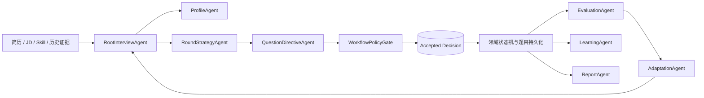

# TRD：Google ADK 动态多轮面试流程编排改造

> 项目：AI-interview  
> 日期：2026-08-19  
> 状态：待实施  
> 前置文档：`TRD_多轮面试持久化工作流与ADK编排优化方案.md`

## 1. 结论

当前系统的 `GOOGLE_ADK` 只决定当前轮题目分类，轮次仍由 `MultiRoundStateMachine.defaultRounds()` 固定为“算法、技术一面、技术二面、HR”。这不是流程自主编排。

目标架构调整为：

1. `GOOGLE_ADK` 会话由 RootAgent 在创建时生成**初始面试图**，包括节点、顺序、进入条件、目标能力、题数和难度范围；不再默认四轮。
2. 每个安全检查点由子 Agent 根据候选人表现修改**未来未开始节点**：可跳过、插入、合并、缩短或扩展后续面试节点。
3. `STATIC_WORKFLOW` / `STATIC_FALLBACK` 才使用版本化的固定四轮定义，作为可靠兜底。
4. 后端返回当前完整的动态流程快照；前端只展示服务端已接受节点，不能手动开始、结束或推进轮次。
5. 题目、答案、静态评审、轮次总结和最终报告仍由领域服务持久化，Agent 永远不能直接写业务表。

## 2. 当前问题

| 问题 | 当前实现 | 风险 |
| --- | --- | --- |
| 流程固定 | 创建时无条件创建四个 `multi_rounds` | 所有候选人走相同流程。 |
| ADK 作用过窄 | `InterviewPlan` 只有 round/type/category/step | 不能改变轮次拓扑、题数或难度。 |
| 前端硬编码 | `ROUND_LABELS`、四格进度条与固定类型颜色 | 无法显示动态节点或新增节点。 |
| 生命周期耦合 | 自动推进按 `roundNo + 1` 找下一轮 | 不能跳过、插入和合并节点。 |
| 报告模型简单 | 仅聚合完成轮次数量 | 无法解释动态调整和面试路径。 |

## 3. 目标能力

### 3.1 初始流程示例

RootAgent 根据简历、JD、目标 Skill、用户难度和可用面试预算生成 3-6 个节点。例如：

```text
候选人 A（Java 后端、有大型分布式项目经验）
算法诊断(2 Medium) -> JVM/并发深挖(3) -> 分布式系统设计(2) -> HR(2)

候选人 B（转行、算法基础待确认）
算法基础诊断(2) -> 算法强化(3 Medium) -> Java 基础/项目实践(3) -> HR(2)

候选人 C（资深架构师）
算法验证(1 Medium) -> 架构设计与取舍(3) -> 领导力/协作(2)
```

算法节点仍必须是 LeetCode Medium 风格题；但数量可由策略限定在 1-3 道，且必须至少存在一个可评估技术能力的节点。

### 3.2 动态调整规则

只允许在以下安全检查点改变未来节点：

- 一个节点内全部题目评审结束。
- 一个节点已完成并已写入轮次总结。
- 用户从 `PAUSED` 会话恢复且当前节点未开始。

允许动作：`KEEP`、`SKIP`、`INSERT_AFTER_CURRENT`、`MERGE_WITH_NEXT`、`REPLACE_FUTURE_NODE`、`CHANGE_QUESTION_COUNT`、`CHANGE_DIFFICULTY_BAND`。

禁止动作：修改已开始节点的题目、删除已完成证据、变更已接受评审结论、超出最大 6 节点或总题数预算、让 Agent 自行定义节点类型或工具。

## 4. Google ADK Agent 图



### 4.1 RootInterviewAgent

- 创建阶段输出 `InitialWorkflowDecision`。
- 节点完成阶段输出 `WorkflowAdaptationDecision`。
- 只能选择白名单节点类型：`ALGORITHM`、`TECHNICAL_FOUNDATION`、`TECHNICAL_PROJECT`、`SYSTEM_DESIGN`、`LEADERSHIP`、`HR`。
- 使用固定图版本和服务端只读工具；不使用自由 Tool、数据库或网络。

### 4.2 子 Agent 职责

| Agent | 职责 | 输出 |
| --- | --- | --- |
| `ProfileAgent` | 将简历/JD 转化为候选能力假设与风险。 | 能力画像，不决定流程。 |
| `RoundStrategyAgent` | 规划初始节点或下一阶段覆盖目标。 | 节点 directive。 |
| `QuestionDirectiveAgent` | 为一个未开始节点确定题型、数量、类别、难度带。 | Question directive。 |
| `EvaluationAgent` | 聚合答案、算法正确性与复杂度评审。 | Evidence summary。 |
| `AdaptationAgent` | 比较覆盖缺口和掌握信号，调整未来图。 | Adaptation actions。 |
| `LearningAgent` | 将评估映射成学习证据。 | Learning evidence。 |
| `ReportAgent` | 基于持久化证据生成总结草稿。 | Narrative draft，不包含事实评分写入。 |

## 5. 后端领域模型改造

### 5.1 节点替代固定轮次

将 `multi_rounds` 从固定 `Type` 轮次扩展为 workflow node：

```java
record WorkflowNodeDefinition(
    String nodeKey,
    String nodeType,
    int displayOrder,
    int minQuestionCount,
    int maxQuestionCount,
    String difficultyBand,
    List<String> coverageKeys,
    List<String> entryConditions,
    NodeStatus status
) {}
```

`multi_rounds` 保留表名以降低迁移风险，新增字段：`node_key`、`node_type`、`display_order`、`difficulty_band`、`coverage_json`、`origin`（`ADK`/`STATIC`）、`decision_id`。原 `round_no` 仅作为显示排序兼容字段，不再作为“下一节点 = +1”的业务规则。

### 5.2 决策模型

新增 `workflow_decision_json` 契约：

```java
record InitialWorkflowDecision(
    String graphVersion,
    List<NodeDirective> nodes,
    int totalQuestionBudget,
    String rationale
) {}

record WorkflowAdaptationDecision(
    String checkpointKey,
    List<NodeMutation> mutations,
    String evidenceSummary,
    String rationale
) {}
```

`WorkflowPolicyGate` 校验：节点类型白名单、算法节点规则、3-6 节点、总题数 8-16、无环、唯一 nodeKey、只修改 `PENDING` 节点、预算不超限。通过后才写入 `multi_round_workflow_decisions` 与领域节点。

### 5.3 状态机

```text
WORKFLOW_READY
  -> NODE_PREPARING (生成该节点题目)
  -> NODE_IN_PROGRESS (用户作答)
  -> NODE_EVALUATING (评审/汇总)
  -> CHECKPOINT_ADAPTING (ADK 或 static 产生未来决策)
  -> NODE_PREPARING | REPORT_GENERATING
  -> COMPLETED

任意非终态 --租约超时--> PAUSED
PAUSED --恢复--> 加载 accepted decision 后继续当前状态
ADK checkpoint 失败 --安全检查点--> STATIC_FALLBACK
```

系统自动推进：节点题目均完成后进入评审；评审结束后运行 checkpoint；下一个已接受且未跳过的节点自动准备和开始。客户端没有开始/结束/下一轮 API。

## 6. 初始化与恢复

### 6.1 新建会话

1. 前端在配置页进入“准备首轮题目”。
2. 后端创建 session、workflow instance、静态 standby definition。
3. `GOOGLE_ADK` 时 RootAgent 生成初始 workflow decision；失败则以 static definition 初始化。
4. Policy Gate 接受 decision，物化第一个节点。
5. QuestionDirectiveAgent/静态执行器生成首节点题目。
6. 首节点与题目持久化成功后，API 才返回 sessionId；前端跳入面试页。

### 6.2 恢复会话

面试记录只传 `sessionId`。后端加载 workflow instance、当前 node、accepted decisions 和事件；不得再次生成初始图或重复已经接受的 ADK decision。若租约过期，记录 `PAUSED`，重新取得租约后继续当前安全点。

## 7. 前端改造

### 7.1 删除固定四轮假设

- 删除 `ROUND_LABELS` 作为流程决定因素、四列栅格和 `roundNo + 1` 推导。
- 改为读取 `WorkflowView.nodes[]`，以服务端 `displayOrder`、`status`、`nodeType`、`title`、`origin` 渲染。
- 节点数量自适应，移动端使用纵向时间线，桌面端使用可横向滚动的步骤条。

### 7.2 动态调整可见性

当前节点显示能力目标、题目完成度和状态；未来节点只展示已接受的目标。系统发生调整时，服务端返回 `workflowRevision` 与 `mutations`：

- `INSERT` 显示新节点与“基于本轮表现新增”的简短原因。
- `SKIP` 保留节点但标记“系统跳过”，不删除历史。
- `REPLACE` 显示新目标，旧待开始节点标记被替代。
- 当前与已完成节点不应发生视觉或题目变化。

不向用户展示内部 Agent trace、模型 prompt 或原始推理；可在报告中展示受控的“面试路径摘要”。

### 7.3 加载与报告体验

- 创建期：配置页禁用重复提交，显示“正在规划面试流程”“正在准备首轮题目”。
- 节点切换：当前节点完成后显示短暂“正在根据表现准备下一阶段”，随后自动展示下一节点。
- 全部节点结束：显示“正在生成总结报告”，轮询 `reportStatus`；报告就绪后展示能力结论、证据、后续学习建议与动态路径。

## 8. API 契约

### 8.1 创建

`POST /api/resumes/{resumeId}/multi-round-interviews`

响应新增：

```json
{
  "sessionId": "...",
  "workflowStatus": "NODE_IN_PROGRESS",
  "workflowRevision": 1,
  "activeNodeKey": "algorithm-diagnosis",
  "nodes": [{"nodeKey":"algorithm-diagnosis","nodeType":"ALGORITHM","status":"IN_PROGRESS"}]
}
```

### 8.2 流程快照

`GET /api/multi-round/interviews/{sessionId}/workflow`

返回 `executionMode`、`workflowRevision`、`activeNodeKey`、所有 nodes、最近一次可展示 mutation 与 `reportStatus`。

### 8.3 用户动作

保留：提交文本答案、提交算法代码、触发算法静态评审、presence heartbeat。

删除：`/rounds/{roundId}/start`、`/rounds/{roundId}/finish`、`/interviews/{sessionId}/next-round`。

## 9. 报告与学习

完成后由确定性报告服务先保存事实快照：节点路径、题目数、算法正确性/复杂度、每类证据、动态调整记录。若 ADK `ReportAgent` 成功，再保存 narrative revision，且不允许覆盖事实字段。

`LearningEvidenceProjection` 以 `categoryKey + evidenceType + score + confidence` 写入学习证据。学习推荐按当前 session 的薄弱项提高优先级，但不在用户未确认时直接修改全局掌握度。

## 10. 迁移与兼容

1. 新建 schema 与 API 支持 dynamic nodes，同时保留旧 `round_no`。
2. 历史已创建会话标记 `LEGACY_STATIC`，按已有节点继续；不重新编排，不重写题目。
3. 新会话通过 feature flag `multi-round.dynamic-adk.enabled` 灰度启用。
4. 发现 ADK 决策校验、超时或 Provider 错误时，安全点切换 `STATIC_FALLBACK`，事件记录错误码。
5. 旧前端仍可读取兼容 rounds；新前端优先读取 workflow nodes。

## 11. 实施阶段

| 阶段 | 内容 | 验收 |
| --- | --- | --- |
| P0 | 抽象 dynamic node、workflow revision、静态四轮 definition | 静态路径保持可创建/恢复/完成。 |
| P1 | RootAgent 初始图与 Policy Gate | 不同简历/JD 可产生不同节点数量和类型。 |
| P2 | 节点完成 checkpoint 与 AdaptationAgent mutation | 可插入/跳过未来节点，不改变已开始节点。 |
| P3 | 前端动态 timeline、创建/切换/报告 loading | 无手动轮次控制，任意节点数显示正常。 |
| P4 | 报告路径摘要与 LearningEvidenceProjection | 报告和学习建议包含多轮证据。 |
| P5 | 灰度、故障注入、恢复压测 | ADK 重启、超时、历史恢复与降级通过。 |

## 12. 验收用例

1. 两份不同资历简历创建 ADK 会话，初始节点图不同，且节点数不固定为四。
2. 算法表现优秀后，后续流程可跳过强化算法节点并提高系统设计权重。
3. 算法复杂度未达标后，系统在后续未开始节点插入算法强化节点。
4. 用户关闭页面后恢复，节点图、已答题、accepted decision 与当前题目完全一致，无重复 RootAgent 调用。
5. ADK 初始编排失败或 checkpoint 超时，静态 workflow 独立完成流程。
6. 前端不展示任何开始/结束/下一轮控制；节点和报告由服务端状态变化驱动。
7. 最终报告包含实际路径、节点调整、算法评审事实和学习建议证据。
