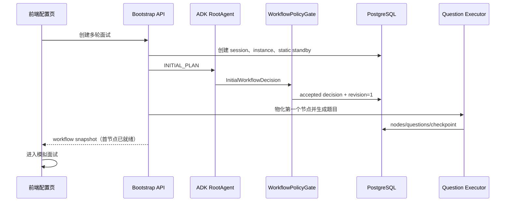

# TRD：多轮面试全流程现状、问题与动态 Google ADK 升级方案

> 项目：AI-interview  
> 日期：2026-08-19  
> 状态：方案待确认  
> 关联：`TRD_多轮面试持久化工作流与ADK编排优化方案.md`、`TRD_ADK动态面试流程编排改造方案.md`

## 1. 目标与结论

多轮面试应是一次以简历、JD、目标岗位和候选人实时表现为输入的动态评估过程。用户不负责控制轮次；系统负责准备首轮、评审、适应、推进、暂停恢复和最终报告。

当前系统已经具备简历绑定、算法题代码编辑和评审、工作流实例/事件/决策持久化、心跳租约、自动开始首轮和自动推进的基础能力，但 `GOOGLE_ADK` 尚未真正决定面试拓扑：会话仍固定为四轮。升级后应满足：

1. `GOOGLE_ADK` 在会话创建时生成初始面试节点图，而不是所有会话固定四轮。
2. 节点完成后，ADK 基于事实证据动态调整未来未开始节点。
3. 用户退出时，服务端保存可恢复 workflow snapshot；再次进入历史记录后从同一 `sessionId` 恢复，不重新编排已接受决策。
4. 静态四轮是独立可靠兜底，不是 ADK 的常态。
5. 前端完全由服务端 workflow snapshot 渲染，不出现“开始本轮/结束本轮/下一轮”手工控制。

## 2. 概念与边界

| 概念 | 定义 |
| --- | --- |
| 面试会话 | `interview_sessions.session_id`，历史记录和恢复的唯一入口。 |
| 多轮面试 | `multi_round_interviews`，绑定一个简历会话、Provider 快照和执行模式。 |
| 节点/轮次 | 当前实现为 `multi_rounds`；升级后为可动态增删改的 workflow node。 |
| 工作流实例 | `multi_round_workflow_instances`，保存模式、定义、游标、检查点、租约和 ADK sessionId。 |
| 已接受决策 | `multi_round_workflow_decisions`，RootAgent/静态执行器在检查点产生且通过策略门校验的不可重放结果。 |
| 事件 | `multi_round_workflow_events`，用于审计、恢复、诊断和学习投影。 |
| 事实数据 | 题目、答案、代码、算法评审、轮次报告；Agent 不能直接修改。 |

硬边界：ADK 只能输出受限结构化 decision；领域服务是状态转移、题目物化、评审、报告和数据库写入的唯一入口。

## 3. 当前真实流程

### 3.1 创建入口

入口位于模拟面试和简历详情页：

```text
用户选择“多轮面试” + 简历/Skill/JD/难度
  -> POST /api/resumes/{resumeId}/multi-round-interviews
  -> 校验简历已完成解析与分析
  -> 创建 interview_session(sourceType=MULTI_ROUND)
  -> 创建 multi_round_interview，固化简历/JD/Provider 快照
  -> MultiRoundStateMachine.defaultRounds() 创建固定四轮
  -> 创建 workflow instance 与静态 definition
  -> 立即启动第一轮，规划并生成题目
  -> 返回 sessionId
  -> 前端导航至 /multi-round?sessionId=...
```

当前前端创建期已显示“正在准备首轮题目”，因此新会话不会再在空白面试页中等待首轮出题。

### 3.2 当前固定轮次

| 顺序 | 当前 `multi_rounds.round_type` | 题目规则 |
| --- | --- | --- |
| 1 | `ALGORITHM` | 强制 3 道 Medium 算法题，代码编辑与静态评审。 |
| 2 | `TECHNICAL_1` | 当前默认为 3 道技术题。 |
| 3 | `TECHNICAL_2` | 当前默认为 3 道系统设计/深度技术题。 |
| 4 | `HR` | 当前默认为 3 道行为题。 |

这四轮来自 `MultiRoundStateMachine.defaultRounds()`，不受 ADK 输出影响，是当前最核心的架构问题。

### 3.3 当前 ADK 处理链路

在运行模式为 `GOOGLE_ADK` 时：

```text
ROUND_START checkpoint
  -> evidence_agent：读取简历、既往答案与轮次报告
  -> adaptation_agent：给出覆盖方向/难度倾向
  -> root_interview_agent：输出当前 InterviewPlan
  -> AgentPlanValidator + WorkflowPolicyGate
  -> 保存 ROUND_PLAN accepted decision
  -> 题目生成服务按 categoryKey 出题
```

当前 `InterviewPlan` 仅包含当前 `roundNo`、`roundType`、分类和 step 数，不能新增、跳过、合并或替换轮次。因此当前 ADK 实际是“受控当前轮规划与出题辅助”，不是面试流程编排器。

### 3.4 当前题目与作答

#### 算法节点

1. 后端要求三道题均为 `ALGORITHM`，难度为 Medium。
2. 新题存储 `question` 与 `problem_json`；`problem_json` 包含标题、描述、输入格式、输出格式、约束与样例。
3. 前端使用三题 tab，每次显示一题及一个代码编辑器。
4. 候选人提交 Java/Python/C++ 代码；系统做 AI 静态评审。
5. 评审以正确性与复杂度为主：正确且满足要求复杂度时服务端给 100 分；不以泛化 performance 为中心。
6. 提交和评审结果都落库，切换 tab 或刷新后可恢复。

#### 非算法节点

1. 题目由 LLM 或确定性 fallback 生成。
2. 候选人提交文本答案，题目状态从 `PENDING` 变为 `ANSWERED`。
3. 当前没有完整的逐题语义评分协议，轮次报告主要是题数与题型聚合；这是学习与动态编排证据不足的来源。

### 3.5 当前自动流转

已实现的行为：

```text
非算法节点：最后一个 PENDING 题被回答
  -> 当前节点完成 -> 生成轮次报告 -> 自动启动下一个固定节点

算法节点：三道题均 EVALUATED
  -> 当前节点完成 -> 生成轮次报告 -> 自动启动下一个固定节点

HR 节点完成
  -> interview COMPLETED -> 持久化最终报告
```

对外的开始/结束/下一轮接口及前端按钮已经删除。问题在于“下一个节点”仍由 `roundNo + 1` 和固定四轮决定。

### 3.6 当前退出、暂停与恢复

当前有以下机制：

1. 面试页进入后立即发送 presence heartbeat，之后每 30 秒续租。
2. `multi_round_workflow_instances.lease_until` 默认在 45 秒后失效。
3. 服务端定时任务每 30 秒扫描 `RUNNING` 且租约过期的实例，写入 `LEASE_EXPIRED` 事件并将状态改为 `PAUSED`。
4. 用户从历史记录按 `sessionId` 进入时，后端加载 workflow instance；若租约到期，恢复接口返回 `PAUSED`；前端重新 heartbeat 后变为 `RUNNING`。
5. 工作流已存储模式、definition、state、checkpoint、ADK sessionId 和 accepted decision。

当前缺口：`state_json` 仍是简化游标，未形成一个足以表达动态节点图、待执行 mutation、当前题目位置、报告状态和学习投影进度的完整 snapshot。

### 3.7 当前报告与学习

1. 最后完成时写入 `multi_round_final_reports`，保存确定性报告快照。
2. 当前报告包含已完成轮数和轮次题型/回答数量，缺少能力评分、动态路径和证据解释。
3. “从面试生成学习建议”当前主要复用全局学习推荐，未将多轮题目类别、算法评审、文本评估映射为独立学习证据。

## 4. 问题清单与升级目标

| 编号 | 当前问题 | 升级目标 |
| --- | --- | --- |
| P1 | 每场均固定四轮 | ADK 初始流程决定 3-6 个节点，静态四轮仅兜底。 |
| P2 | ADK 不能调整未来流程 | 节点完成 checkpoint 支持 skip/insert/replace/merge/difficulty/题数调整。 |
| P3 | 前端固定四格 | 动态时间线和服务端 revision 驱动的节点展示。 |
| P4 | 退出状态不完整 | 每次退出/租约超时持久化完整 workflow snapshot。 |
| P5 | 非算法证据弱 | 统一文本题评分事实与能力 evidence。 |
| P6 | 报告过于计数化 | 输出真实面试路径、能力结论、算法事实、调整原因和学习建议。 |
| P7 | ADK 内存 session 不可靠 | PostgreSQL snapshot/decision/event 为恢复真相，ADK session 仅运行容器。 |

## 5. 目标动态 workflow

### 5.1 节点类型与预算

允许的节点类型：

| nodeType | 目的 | 题数范围 |
| --- | --- | --- |
| `ALGORITHM` | 算法正确性、复杂度和编码能力 | 1-3，均为 Medium。 |
| `TECHNICAL_FOUNDATION` | 语言、框架、基础原理 | 2-4。 |
| `TECHNICAL_PROJECT` | 简历项目、工程取舍与排障 | 2-4。 |
| `SYSTEM_DESIGN` | 架构、容量、高可用与权衡 | 1-3。 |
| `LEADERSHIP` | 技术领导、协作、影响力 | 1-3。 |
| `HR` | 动机、价值观与行为面试 | 1-3。 |

策略门约束：初始 3-6 个节点，总题数 8-16，至少一个技术节点；需要算法验证的目标岗位至少一个 `ALGORITHM` 节点。所有节点均有稳定 `nodeKey`，而非使用固定 `roundNo` 作为身份。

### 5.2 初始编排



如果 Provider/ADK/校验失败，`WorkflowPolicyGate` 记录失败事件并选择 `STATIC_WORKFLOW` 定义，仍保证首节点题目准备完成后才返回。

### 5.3 节点完成后的动态调整

```text
题目完成 -> 评审完成 -> 保存节点事实报告
  -> EvaluationAgent 提取能力 evidence
  -> AdaptationAgent 比较目标覆盖、预算和未来节点
  -> RootAgent 输出 WorkflowAdaptationDecision
  -> PolicyGate 校验并接受 decision
  -> revision + 1，物化/更新未来 PENDING 节点
  -> 自动准备第一个可执行节点
```

允许的 mutation：

| 动作 | 约束 |
| --- | --- |
| `KEEP` | 保持未来节点。 |
| `SKIP` | 只可跳过 `PENDING` 节点，保留审计记录。 |
| `INSERT_AFTER_CURRENT` | 节点数和总题数不得超过预算。 |
| `REPLACE_FUTURE_NODE` | 旧节点标记 `REPLACED`，不得物理删除。 |
| `MERGE_WITH_NEXT` | 合并两个未开始、兼容能力目标的节点。 |
| `CHANGE_QUESTION_COUNT` | 必须在 node 的 min/max 内。 |
| `CHANGE_DIFFICULTY_BAND` | 不能改变已物化题目；只影响未来出题。 |

示例：算法三题全部正确且复杂度达标时，跳过“算法强化”候选节点，增加系统设计深度；若算法正确性不足，则插入一个 2 题的算法强化节点，减少一个低优先级基础题节点以守住总预算。

## 6. 用户退出时的 Workflow Snapshot 协议

### 6.1 退出检测

不能将浏览器 `beforeunload` 视为可靠信号。采用组合检测：

1. 前端每 30 秒调用 presence；页面再次可见时立即调用。
2. `pagehide` / `visibilitychange(hidden)` 发送 best-effort pause beacon，只用于加速，不作为唯一依据。
3. 服务端以 `lease_until` 超时为最终判断，定时扫描后执行 `PAUSE_TIMEOUT`。
4. 长耗时评审/出题任务拥有 worker lease；任务 lease 失效时按幂等 key 恢复或标记可重试，不能直接重复写题。

### 6.2 必须原子保存的内容

检测到退出、租约超时、网络断连或主动暂停时，在同一数据库事务内写：

```json
{
  "workflowId": 42,
  "revision": 5,
  "executionMode": "GOOGLE_ADK",
  "graphVersion": "interview-graph-v2",
  "checkpointKey": "NODE_system-design_EVALUATING",
  "activeNodeKey": "system-design",
  "activeQuestionId": 901,
  "nodeStates": [{"nodeKey":"algorithm","status":"COMPLETED"}],
  "acceptedDecisionIds": [101, 102, 103],
  "pendingMutations": [],
  "reportStatus": "NOT_STARTED",
  "learningProjectionStatus": "PENDING",
  "adkSessionId": "mr-workflow-...",
  "reason": "LEASE_EXPIRED"
}
```

持久化动作：更新 `workflow_instance.state_json/status/lease_until`，插入 `WORKFLOW_PAUSED` 或 `LEASE_EXPIRED` event，必要时插入任务恢复记录。题目、答案、代码、评审和 accepted decision 已分别落表，不复制为易漂移的事实来源；snapshot 只保存它们的引用与当前游标。

### 6.3 恢复规则

1. 仅通过 `sessionId` 加载实例与最新 snapshot。
2. 若 checkpoint 对应 decision 已被接受，绝不再次请求 RootAgent。
3. 若退出发生在题目作答中，恢复到同一题目和已保存草稿/代码版本。
4. 若退出发生在评审中，读取评审任务幂等键：已完成则加载结果，未完成则恢复同一任务，禁止创建第二次评分。
5. 若退出发生在 adaptation 前，恢复后从该 checkpoint 运行一次；其输出经唯一键和 revision CAS 保证只接受一次。
6. 若 ADK 恢复不可用，只在未接受新 decision 的安全点转 `STATIC_FALLBACK`，并保留原 ADK 历史。

## 7. 数据模型升级

### 7.1 `multi_round_workflow_instances`

新增/强化字段：

| 字段 | 说明 |
| --- | --- |
| `workflow_revision` | 乐观锁版本，防止并发 heartbeat/评审/恢复覆盖。 |
| `graph_version` | Agent 图与静态定义版本。 |
| `active_node_key` | 当前节点，而非仅 `current_round_no`。 |
| `active_question_id` | 恢复定位。 |
| `state_json` | 第 6 节定义的 snapshot。 |
| `pause_reason` | `USER_HIDDEN`、`LEASE_EXPIRED`、`NETWORK_LOST`、`SYSTEM_RECOVERY`。 |
| `report_status` | `NOT_STARTED`、`GENERATING`、`COMPLETED`、`FAILED`。 |
| `learning_projection_status` | `PENDING`、`PROCESSING`、`COMPLETED`、`FAILED`。 |

### 7.2 `multi_rounds` 演进为动态 node

| 字段 | 说明 |
| --- | --- |
| `node_key` | 全会话稳定唯一键。 |
| `node_type` | 新节点类型。 |
| `display_order` | 前端显示顺序，可被未来 revision 重排。 |
| `origin` | `ADK`、`STATIC`、`ADK_ADAPTED`。 |
| `decision_id` | 创建/修改该节点的 accepted decision。 |
| `difficulty_band` | 题目难度区间。 |
| `coverage_json` | 能力覆盖和目标权重。 |
| `status` | 增加 `PREPARING`、`SKIPPED`、`REPLACED`、`EVALUATING`。 |

旧 `round_no` 与 `round_type` 在迁移期保留，给旧 API 和历史数据兼容使用。

### 7.3 新增表

1. `multi_round_workflow_snapshots`：关键 revision 的不可变快照，支持恢复审计和回放。
2. `multi_round_node_evidence`：每节点、每类别的评估事实、置信度和来源。
3. `multi_round_workflow_mutations`：将 decision 内的 mutation 拆为可查询记录。
4. `multi_round_execution_tasks`：出题、评审、报告和学习投影的幂等后台任务。
5. `learning_evidence`：与全局学习进度解耦的候选人证据事实。

## 8. API 设计

### 8.1 创建与恢复

`POST /api/resumes/{resumeId}/multi-round-interviews`

仅在首节点题目已落库后返回：

```json
{
  "sessionId": "...",
  "workflowStatus": "NODE_IN_PROGRESS",
  "workflowRevision": 1,
  "activeNodeKey": "algorithm-diagnosis",
  "nodes": [{"nodeKey":"algorithm-diagnosis","nodeType":"ALGORITHM","status":"IN_PROGRESS"}]
}
```

`GET /api/multi-round/interviews/{sessionId}/workflow`

返回完整 workflow view、revision、active node、report status、可展示的 mutation summary。前端每次自动节点切换或恢复后以此为准。

### 8.2 用户动作

保留：

- 提交文本答案
- 保存/提交算法代码
- 发起算法评审
- presence heartbeat
- 可选的答题草稿保存

禁止对外暴露：开始节点、结束节点、推进下一节点、手工修改 workflow mutation。

### 8.3 事件推送

优先使用 SSE：`GET /api/multi-round/interviews/{sessionId}/events`。至少推送：`NODE_PREPARING`、`NODE_READY`、`NODE_COMPLETED`、`WORKFLOW_ADAPTED`、`WORKFLOW_PAUSED`、`REPORT_GENERATING`、`REPORT_COMPLETED`、`STATIC_FALLBACK`。SSE 不可用时前端每 3 秒轮询 workflow view。

## 9. 前端完整流程

### 9.1 创建期

```text
配置页点击开始
  -> 禁止重复点击
  -> 正在规划面试流程
  -> 正在准备首轮题目
  -> workflowStatus=NODE_IN_PROGRESS
  -> 跳转面试页
```

### 9.2 面试期

1. 渲染服务端 nodes，不假设数量为四，也不硬编码轮次名称。
2. 当前节点显示能力目标、题目进度、题面与输入控件。
3. 未来节点展示已接受目标；`SKIPPED`/`REPLACED` 节点保留为历史路径标记。
4. 节点完成后显示“正在根据本轮表现准备下一阶段”，等待 `NODE_READY`。
5. 不渲染手工开始、结束或下一轮按钮。
6. 页面隐藏后停止前端轮询；服务端租约负责可靠暂停。

### 9.3 恢复期

历史记录点击 session 后：先请求 workflow snapshot，再加载当前节点题目和草稿；若 `PAUSED`，发送 heartbeat 并展示“已恢复至上次进度”。不重新生成流程，也不跳到新的题目。

### 9.4 报告期

所有节点完成后，前端展示 `REPORT_GENERATING`，等待报告快照。报告包括：实际节点路径、被跳过/新增节点、每类能力证据、算法正确性与复杂度事实、优势/风险、学习建议。报告完成后才显示“本次多轮面试完成”。

## 10. 静态可靠兜底

| 场景 | 行为 |
| --- | --- |
| 初始 ADK 不可用 | 用静态 definition 初始化，准备首轮后返回。 |
| checkpoint ADK 超时/校验失败 | 在安全点转 `STATIC_FALLBACK`，不回切。 |
| 数据库可用但模型不可用 | 静态题库、规则评审和确定性报告仍可完成。 |
| 用户退出/恢复 | 静态与 ADK 使用同一 snapshot 协议。 |

静态 definition 保留四轮只是一个版本化的 fallback 策略，可随版本调整；不得再把它作为所有 ADK 会话的默认流程。

## 11. 实施阶段

| 阶段 | 后端 | 前端 | 验收 |
| --- | --- | --- | --- |
| P0 | 完整 snapshot、revision、退出任务恢复 | workflow view 读取与 heartbeat | 退出/恢复不丢游标。 |
| P1 | dynamic node schema、兼容旧 rounds | 动态 timeline | 3-6 节点显示正确。 |
| P2 | RootAgent 初始图、PolicyGate | 创建期流程 loading | 不同简历得到不同初始路径。 |
| P3 | Evaluation/Adaptation mutation | 节点调整可视化 | 只改未来节点。 |
| P4 | 统一证据、报告任务、学习投影 | 报告 loading 与路径摘要 | 报告反映真实路径。 |
| P5 | 灰度、故障注入、监控 | SSE/轮询容错 | ADK/恢复/降级全链路通过。 |

## 12. 验收用例

1. 两份不同资历/目标的简历创建 ADK 会话，节点数或节点类型不同，且不是固定四轮。
2. 算法高分后跳过未来算法强化节点并提升系统设计覆盖；算法低分后插入强化节点。
3. 用户在任意节点作答、代码编辑、评审、适应和报告阶段退出，均有 workflow snapshot 与恢复路径。
4. 恢复 session 后不重新调用已经接受的 RootAgent decision；题目、代码、评审和节点顺序保持一致。
5. ADK 故障仅在安全点进入静态 fallback，已完成和已开始节点不被改写。
6. 前端没有手工轮次控制，所有状态变化由 workflow view/event 驱动。
7. 最终报告包含实际面试路径、动态 mutation、评审事实和学习证据。
