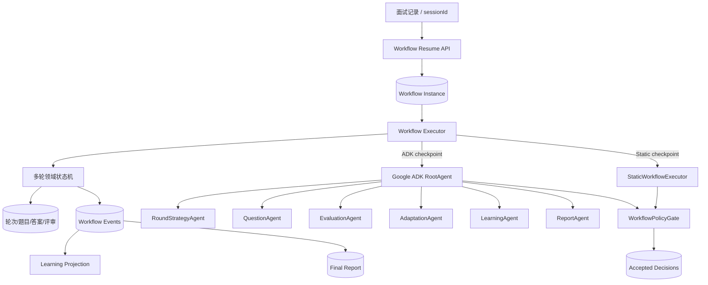

# TRD：多轮面试双轨工作流与 Google ADK 自主编排升级

> 项目：AI-interview  
> 版本：2.0  
> 状态：待评审  
> 日期：2026-08-19  
> 关联：`TRD_Google_ADK_受控面试编排升级.md`、`TRD_学习对话多轮面试技术需求.md`

## 1. 结论

多轮面试采用双轨体系：

1. **可靠静态 workflow**：不依赖 Google ADK、Provider、网络模型调用或 ADK 内存会话。任何时候均可独立完成四轮面试、学习信号与确定性报告。
2. **Google ADK 自主编排 workflow**：会话级 RootAgent 管理固定的子 Agent 图。子 Agent 在持久化 checkpoint 中，根据新回答、算法评审、覆盖度和学习信号动态调整后续方向。

两条路径共享领域状态机、题目/答案/评审数据、workflow instance、学习投影和报告协议。差异仅在待决策 checkpoint 由 ADK 子 Agent 还是 StaticWorkflowExecutor 生成 accepted decision。

```text
固定：会话执行模式、Agent 图版本、策略版本、已接受 decision、已完成节点。
动态：未来尚未到达 checkpoint 的策略、题目、难度、覆盖度和学习建议。
恢复：加载同一 instance，绝不重复 accepted decision，只继续当前 checkpoint。
```

## 2. 现状与目标

现有 `AdkInterviewPlanner` 是单个 `LlmAgent`，每次 `ROUND_START` 根据简历快照、JD、Skill、难度、当前轮次、历史题目/回答/报告输出当前轮 `InterviewPlan`。它没有 RootAgent、子 Agent 图、持久化 runtime state 或 decision journal；`InMemorySessionService` 重启后丢失；学习推荐未消费多轮证据，最终报告只是轮次计数。

本升级目标：

1. 面试记录按 `sessionId` 恢复 workflow，不再按 resume/JD scope 查找或重新初始化 RootAgent。
2. 先落地完整静态 workflow，再叠加 ADK 动态编排。
3. ADK 会话可依据真实表现动态调整未来未落库节点。
4. ADK 故障时只在安全 checkpoint 一次性转入静态 continuation，不在同一节点混用两种策略。
5. 多轮表现进入学习掌握度和完整报告闭环。

## 3. 总体架构



硬边界：Agent 只返回结构化建议；Spring 领域服务是状态转换和业务写库的唯一入口。ADK session 只是运行容器，PostgreSQL workflow、decision 和 event 是恢复真相来源。

## 4. 双轨执行模式

| 模式 | 含义 | UI |
| --- | --- | --- |
| `GOOGLE_ADK` | 主路径，动态 checkpoint 由 ADK Agent 图决策。 | Google ADK 自主编排 |
| `STATIC_WORKFLOW` | 初始 ADK 不可用时选择的完整确定性流程。 | 静态工作流 |
| `STATIC_FALLBACK` | ADK 会话在安全 checkpoint 致命失败后的一次性 continuation。 | ADK 已降级为静态工作流 |

`GOOGLE_ADK` 和 `STATIC_WORKFLOW` 是创建时初始模式。`STATIC_FALLBACK` 是唯一模式转换，必须满足：当前节点尚未写入 accepted decision，未执行不可逆写操作或已有幂等完成证据，切换事件和失败码已持久化。切换后不可回到 ADK。

因此不会发生“ADK 出半道题，静态流程续半道题”的混用；只会在节点边界从一个完整执行器切换至另一个完整执行器。

## 5. 静态 workflow：先可靠兜底

静态 workflow 不是依赖 LLM 的弱化版，必须离线完成核心流程。

| 节点 | 静态行为 |
| --- | --- |
| 初始化 | 固定四轮、题数、转移条件、题库和规则版本。 |
| 算法轮 | 从版本化内置 Medium 题库选三道互异题，题面完整。 |
| 技术一面 | 按 Skill 题库选基础原理、项目实践、工程能力题。 |
| 技术二面 | 按 Skill 题库选系统设计、容量、可靠性、取舍题。 |
| HR | 使用版本化行为题库和 STAR 追问模板。 |
| 调整 | 基于规则表修改未来未物化题目，如算法薄弱时加强边界/复杂度验证。 |
| 学习 | 按类别、评分和完成情况生成 evidence。 |
| 报告 | 汇总持久化数据生成确定性报告。 |

静态题库、调整规则、学习规则和报告模板均带版本。Provider、ADK、网络全部不可用时，静态 workflow 仍能创建、暂停、恢复、完成和报告。

## 6. Google ADK 自主编排

### 6.1 RootAgent

RootAgent 是会话级控制器，不直接出题或写库。它建立固定 Agent 图，选择每个 checkpoint 可运行的子 Agent，汇总 outputs 为候选 decision。RootAgent 只能选择服务端预定义 Agent 集合和 checkpoint 拓扑，不能生成任意循环、Agent、Tool、HTTP 或数据库动作。

```java
record AgentGraphPlan(
    String graphVersion,
    List<String> enabledAgents,
    List<String> checkpointOrder,
    List<String> allowedCategoryKeys
) {}
```

### 6.2 子 Agent

| Agent | 输入 | 输出 | 动态作用 |
| --- | --- | --- | --- |
| `RoundStrategyAgent` | 简历、JD、历史表现、覆盖度 | 下一轮策略 | 目标类别、难度、题数范围。 |
| `QuestionAgent` | 已接受策略、题库/上下文 | Question directives | 仅生成未落库题目。 |
| `EvaluationAgent` | 回答、算法评审、参考点 | Evaluation summary | 优势、风险、类别证据。 |
| `AdaptationAgent` | 评估、未来节点 | Adaptation decision | 上调/下调难度、调整覆盖度、追问。 |
| `LearningAgent` | 表现与历史进度 | Learning evidence | 掌握度信号、学习优先级。 |
| `ReportAgent` | 全部已持久化证据 | Report draft | 最终总结。 |

一期禁止开放式 Agent-to-Agent 委派。RootAgent 只编排这组固定子 Agent。

### 6.3 动态调整示例

```text
算法轮完成
  -> EvaluationAgent 归纳正确性、复杂度、薄弱类别
  -> AdaptationAgent 决定技术一面的难度与优先类别
  -> QuestionAgent 仅生成技术一面尚未落库的问题

技术一面表现优秀
  -> 技术二面转向系统设计、可靠性、容量推导和权衡

技术一面表现不足
  -> 保持核心深度，增加基础能力和证据型追问
```

动态决策只能修改未来未 materialize 节点；候选人已经看到、回答或提交的题目永不被替换。

### 6.4 Tool 白名单

所有 Agent 仅能读取绑定当前 `interviewId` 的受限数据：

| Tool | 允许 Agent | 输出 |
| --- | --- | --- |
| `read_interview_snapshot` | Root、Strategy、Question | 截断简历/JD/Skill/难度。 |
| `read_round_state` | Root、Strategy、Adaptation | 当前节点、轮次、覆盖度。 |
| `read_prior_answers` | Evaluation、Adaptation、Report | 历史回答摘要。 |
| `read_algorithm_reviews` | Evaluation、Adaptation、Learning、Report | 正确性、复杂度、评分。 |
| `read_round_reports` | Strategy、Adaptation、Report | 已完成轮次报告。 |
| `read_learning_progress` | Learning、Report | 类别掌握度摘要。 |
| `read_question_coverage` | Strategy、Question、Adaptation | 已覆盖和剩余类别。 |

Tool 不接受浏览器提供的 interview ID，不返回 Entity、Provider 配置、密钥、其他会话或完整 prompt。

## 7. 持久化 Agent State 与 Workflow

### 7.1 模型

| 对象 | 内容 | 规则 |
| --- | --- | --- |
| `WorkflowDefinition` | static standby DSL、ADK graph、模式、策略和题库版本 | 初始化后不可修改。 |
| `WorkflowInstance` | 当前 checkpoint、状态、revision、lease、active mode | 仅 CAS 推进。 |
| `AgentDecision` | 策略、题目指令、适应决策、学习/报告草案 | `ACCEPTED` 后不可替换。 |
| `WorkflowEvent` | 节点开始、接受、物化、暂停、恢复、切换、投影 | append-only、event key 去重。 |

### 7.2 ADK Memory

`InMemorySessionService` 不能作为恢复基础。增加 `adk_agent_sessions`、`adk_agent_checkpoints`、`adk_agent_decisions`：保存逻辑 session、graph version、安全 `state_json`、checkpoint 状态、输入 hash、决策 JSON/hash、拒绝原因和重试数。

优先实现 `PersistentAdkSessionStore` 作为 ADK Session/State 的 PostgreSQL 适配；若当前 ADK Java 版本没有安全 SPI，则将 ADK session 视为短生命周期，恢复时用持久化 state、tool result 摘要、accepted decision 确定性重建同一 Agent graph。无论方案如何，PostgreSQL 都是恢复依据。

### 7.3 Checkpoint 状态机

```text
READY -> RUNNING -> DECIDING -> DECISION_ACCEPTED -> MATERIALIZING
      -> WAITING_FOR_CANDIDATE -> EVALUATING -> COMPLETED

任一节点可转：PAUSED / RETRYABLE_FAILED / STATIC_FALLBACK
```

恢复或重试时先查询 checkpoint 是否已有 accepted decision；存在则直接物化/展示，禁止再次运行 Agent。

## 8. 退出、暂停与恢复

浏览器退出用 heartbeat lease 检测，而不依赖不可靠的关闭事件：

1. `POST /workflow/resume` 抢占 90 秒 lease。
2. 前端每 20 秒 heartbeat，带 instance revision 与浏览器实例 ID。
3. `visibilitychange/pagehide` best-effort pause，不作为最终依据。
4. 定时任务将过期 `RUNNING/WAITING_FOR_CANDIDATE` 条件更新为 `PAUSED`。
5. lease 超时不代表失败或完成。

面试记录点击流程：

```text
/multi-round?sessionId={sessionId}
  -> POST /api/multi-round/interviews/{sessionId}/workflow/resume
  -> load instance + accepted decisions + 领域数据
  -> 等待候选人：展示已有题目/答案/代码/评审
  -> 等待决策：继续当前 checkpoint
```

恢复绝不按 resume/JD/Skill scope 查找，绝不重跑 RootAgent。

所有节点使用 revision CAS 与 event key，例如：

```text
workflow:{workflowId}:checkpoint:{checkpointId}:decision:{decisionHash}
```

## 9. Flyway 数据模型

### 9.1 Workflow 表

新增 `V20260903__add_multi_round_workflow.sql`：

```sql
CREATE TABLE multi_round_workflow_definitions (
  id BIGINT GENERATED BY DEFAULT AS IDENTITY PRIMARY KEY,
  multi_round_interview_id BIGINT NOT NULL UNIQUE REFERENCES multi_round_interviews(id),
  initial_mode VARCHAR(32) NOT NULL,
  active_mode VARCHAR(32) NOT NULL,
  schema_version INTEGER NOT NULL,
  graph_version VARCHAR(64) NOT NULL,
  policy_version VARCHAR(64) NOT NULL,
  static_workflow_json TEXT NOT NULL,
  adk_graph_json TEXT,
  provider_id VARCHAR(64), provider_fingerprint VARCHAR(64),
  fallback_reason VARCHAR(64), created_at TIMESTAMP(6) NOT NULL,
  CONSTRAINT workflow_initial_mode_check CHECK (initial_mode IN ('GOOGLE_ADK','STATIC_WORKFLOW')),
  CONSTRAINT workflow_active_mode_check CHECK (active_mode IN ('GOOGLE_ADK','STATIC_WORKFLOW','STATIC_FALLBACK'))
);

CREATE TABLE multi_round_workflow_instances (
  id BIGINT GENERATED BY DEFAULT AS IDENTITY PRIMARY KEY,
  workflow_definition_id BIGINT NOT NULL UNIQUE REFERENCES multi_round_workflow_definitions(id),
  status VARCHAR(32) NOT NULL, current_checkpoint_id VARCHAR(128) NOT NULL,
  revision BIGINT NOT NULL DEFAULT 0, lease_owner VARCHAR(128),
  lease_expires_at TIMESTAMP(6), last_heartbeat_at TIMESTAMP(6), pause_reason VARCHAR(64),
  started_at TIMESTAMP(6), completed_at TIMESTAMP(6),
  created_at TIMESTAMP(6) NOT NULL, updated_at TIMESTAMP(6) NOT NULL
);

CREATE TABLE multi_round_workflow_events (
  id BIGINT GENERATED BY DEFAULT AS IDENTITY PRIMARY KEY,
  workflow_instance_id BIGINT NOT NULL REFERENCES multi_round_workflow_instances(id),
  event_key VARCHAR(192) NOT NULL, event_type VARCHAR(64) NOT NULL,
  checkpoint_id VARCHAR(128), payload_json TEXT, created_at TIMESTAMP(6) NOT NULL,
  CONSTRAINT workflow_event_key_unique UNIQUE(workflow_instance_id, event_key)
);
```

### 9.2 Agent、学习和报告表

新增 `V20260904__add_adk_workflow_runtime.sql`：`adk_agent_sessions`、`adk_agent_checkpoints`、`adk_agent_decisions`，分别保存逻辑会话 state、子 Agent checkpoint、候选/接受 decision。

新增 `V20260905__add_multi_round_learning_and_report.sql`：

```sql
CREATE TABLE learning_evidence_events (
  id BIGINT GENERATED BY DEFAULT AS IDENTITY PRIMARY KEY,
  event_key VARCHAR(192) NOT NULL UNIQUE,
  source_type VARCHAR(32) NOT NULL, source_session_id VARCHAR(64) NOT NULL,
  skill_id VARCHAR(64) NOT NULL, category_key VARCHAR(128), signal_type VARCHAR(64) NOT NULL,
  score INTEGER, delta INTEGER, evidence_json TEXT, projection_status VARCHAR(32) NOT NULL,
  projected_at TIMESTAMP(6), created_at TIMESTAMP(6) NOT NULL
);

CREATE TABLE multi_round_reports (
  id BIGINT GENERATED BY DEFAULT AS IDENTITY PRIMARY KEY,
  multi_round_interview_id BIGINT NOT NULL UNIQUE REFERENCES multi_round_interviews(id),
  status VARCHAR(32) NOT NULL, source_mode VARCHAR(32) NOT NULL,
  report_version VARCHAR(64) NOT NULL, report_json TEXT, error_code VARCHAR(64),
  generated_at TIMESTAMP(6), created_at TIMESTAMP(6) NOT NULL, updated_at TIMESTAMP(6) NOT NULL
);
```

历史进行中会话首次读取时创建引用既有题目/轮次的 `STATIC_WORKFLOW` definition；禁止重复生成历史题目。

## 10. Policy Gate 与领域写入

`WorkflowPolicyGate` 对 ADK 与静态 decision 一视同仁：

1. 固定四轮顺序，禁止跳轮。
2. 算法轮固定三道 Medium `ALGORITHM` 题。
3. 分类来自当前 Skill 白名单。
4. 只能修改未来未物化节点。
5. 题数、追问数、输入输出、Tool、超时预算受限。
6. decision 与当前 revision、checkpoint、输入 hash 匹配。
7. 所有领域写入继续通过 `MultiRoundLifecycleService`、回答服务、算法提交/评审服务完成。

`MultiRoundLifecycleService` 改为从 Workflow Executor 获取“当前 accepted decision”，不再每次 `ROUND_START` 直接调用 planner。

## 11. 学习与报告闭环

### 11.1 学习 evidence

| 触发点 | 信号 |
| --- | --- |
| 算法评审完成 | 正确性、复杂度、评分、算法类别。 |
| 技术题评估完成 | 类别掌握、论证深度、薄弱点。 |
| 适应决策接受 | 难度/方向调整原因。 |
| 轮次完成 | 覆盖度与轮次表现。 |
| 最终报告完成 | 学习优先级。 |

领域提交后写入去重 `learning_evidence_events`；`LearningEvidenceProjectionService` 独立投影到 `LearningProgressEntity`。`recommendations/from-interview/{sessionId}` 返回本场 evidence、掌握度变化、对应 source 和推荐，不能只返回无关的全局列表。

### 11.2 最终报告

`final-report` 是 workflow checkpoint：HR 完成后创建 `PENDING -> GENERATING -> COMPLETED/FAILED` 报告任务。ADK 模式用 ReportAgent；静态模式或 Agent 失败时使用确定性模板。报告失败不回滚已完成面试，允许幂等重试。

报告包含整体总结、每轮表现、算法正确性/复杂度、优势、改进项、岗位匹配证据、学习优先级、Agent 适应决策摘要、执行模式及降级说明。

## 12. API 与前端

| Method | Endpoint | 说明 |
| --- | --- | --- |
| `POST` | `/api/multi-round/interviews/{sessionId}/workflow/resume` | 从记录恢复并取得 lease。 |
| `POST` | `/api/multi-round/interviews/{sessionId}/workflow/heartbeat` | 续租，带 revision。 |
| `POST` | `/api/multi-round/interviews/{sessionId}/workflow/pause` | 幂等暂停。 |
| `GET` | `/api/multi-round/interviews/{sessionId}/workflow` | mode、checkpoint、状态、definition 摘要。 |
| `GET` | `/api/multi-round/interviews/{sessionId}/report` | 持久化报告或状态。 |
| `POST` | `/api/multi-round/interviews/{sessionId}/report/retry` | 失败报告重试。 |

前端：记录入口只携带 `sessionId`；挂载时 resume 并启动 20 秒 heartbeat；展示固定 mode；每个技术/HR `questionId` 有独立草稿和提交状态；`WAITING_FOR_CANDIDATE` 只显示已持久化题目，`DECIDING` 显示安全的规划中状态；报告展示本场学习证据。

## 13. 实施顺序

### Phase 0：可靠静态 workflow

1. 实现静态 DSL、版本化题库、规则和确定性报告模板。
2. 新增 workflow definition/instance/event 表和 StaticWorkflowExecutor。
3. 接入现有四轮状态机，完成 pause/resume/lease/幂等及历史 backfill。
4. 验收：关闭 Provider 后仍可创建、恢复、完成四轮、生成学习 evidence 和报告。

### Phase 1：ADK RootAgent 与持久化状态

1. 实现固定 Agent graph、RootAgent、子 Agent、Tool policy 和 persistent session/checkpoint/decision 表。
2. RootAgent 初始化 graph，未来 checkpoint 决策由对应子 Agent 动态产生。
3. accepted decision 后才 materialize 题目或推进领域状态。
4. 已创建会话不受全局 runtime 改动影响。

### Phase 2：安全降级与动态调整

1. 预生成 static standby workflow。
2. 实现 ADK 失败分类、safe checkpoint 判断和不可逆 `STATIC_FALLBACK`。
3. 接入算法/技术表现对后续难度、方向、覆盖度和追问的动态调整。

### Phase 3：学习和报告

1. 接入 evidence 事件、异步掌握度投影和面试内推荐。
2. 接入 LearningAgent、ReportAgent、确定性学习/报告降级和重试。
3. 完成报告页与学习证据 UI。

## 14. 验收标准

### 静态 workflow

1. ADK、LLM、网络全部不可用时仍能完成一场四轮面试。
2. 从面试记录恢复同一 `sessionId`、同一题目、答案、算法提交、评审和 checkpoint。
3. 刷新、多标签页、网络重试不会重复生成题目或重复投影 evidence。

### ADK workflow

1. `GOOGLE_ADK` 会话有 RootAgent 和动态子 Agent checkpoint，不是每轮单一 planner。
2. 表现优秀时后续提升为系统设计/可靠性/容量权衡；表现不足时加强相应验证，不改变历史题目。
3. 重启恢复不重跑 accepted decision；全局 runtime 变更不改变既有会话 mode/graph。
4. 致命 ADK 失败仅在安全 checkpoint 一次性切换到静态 continuation。

### 学习与报告

1. 算法评审、轮次完成和最终报告均产生去重 evidence。
2. 推荐能解释本场哪个证据导致哪项推荐。
3. 报告包含每轮表现、算法结果、适应决策、优势短板和学习优先级；ADK 报告失败仍有确定性报告。

## 15. 风险控制

| 风险 | 控制 |
| --- | --- |
| ADK/Provider 不稳定 | 静态 workflow 先完整上线；ADK 是可审计主路径。 |
| 动态决策不可解释 | input hash、decision JSON、policy gate、accepted/rejected 审计。 |
| 模式混用 | active mode 不受全局配置覆盖，仅允许一次安全 fallback。 |
| 重启丢失 ADK 内存 | PostgreSQL checkpoint/decision/state 为恢复真相。 |
| 并发恢复 | lease owner、revision CAS、event key、decision hash 唯一约束。 |
| 学习重复计分 | evidence event key 全局唯一，投影独立幂等。 |
| 报告失败阻塞面试 | 异步、确定性降级、可重试，不回滚面试。 |

## 16. 完成定义

1. 静态 workflow 在所有 Agent/LLM 不可用时独立可靠运行。
2. ADK 模式是 RootAgent + 动态子 Agent checkpoint 体系，而非单轮 planner。
3. 从面试记录恢复基于 `sessionId` 与持久化 workflow，不重复 RootAgent 或 accepted decision。
4. ADK/静态模式会话级固定，ADK 只可安全一次性降级到静态 continuation。
5. 新表现能动态改变未来未物化的方向、难度、覆盖度与学习建议。
6. 多轮证据真实进入学习掌握度，完成后生成可追溯完整报告。
