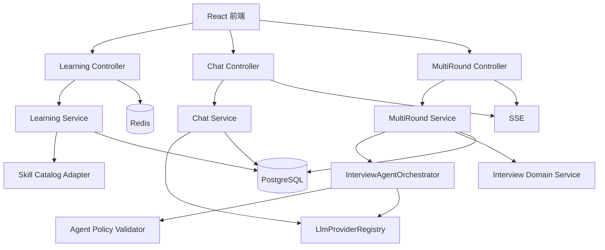

# TRD：学习、普通对话与多轮面试能力技术需求

> 项目：`Interview-guide/interview-guide`  
> 版本：1.0  
> 文档性质：技术需求文档（Technical Requirements Document）  
> 实施范围：自适应学习、普通 Chat、多轮面试；不包含旧项目数据迁移和代码执行沙箱。  
> 技术基线：Java 25、Spring Boot 4.1、Spring AI 2、PostgreSQL + pgvector、Redis Stack、RustFS、React 18、TypeScript、Vite。

## 1. 目的、边界与结论

本 TRD 将旧项目中的学习、普通 Chat、多轮面试能力迁移为当前项目可维护的领域模块。目标不是复制旧项目源码，而是复用当前项目已有的 LLM Provider、Skill、面试会话、RAG Chat、Redis 限流和 Flyway 机制。

已确认的产品约束：

| 编号 | 技术决策 |
| --- | --- |
| D-01 | 多轮面试由受控 Agent 编排；Agent 只能提出结构化计划，不能直接写库或调用任意工具。 |
| D-02 | 算法题提供 Java、Python、C++ 三种模板；一期只做 AI 静态评审，不执行代码。 |
| D-03 | 普通 Chat 会话创建后固定 Provider，不允许在会话内切换。 |
| D-04 | 学习目录覆盖所有可解析 `skills/*/SKILL.md` 与 `skill.meta.yml` 中的主题和分类。 |
| D-05 | 学习计划支持日期任务、站内提醒和浏览器通知。 |
| D-06 | 不迁移 `Work-inflow/interview-guide` 的历史数据。 |

不在本期范围：账号/多租户权限、运行用户代码、离线推送、邮件/短信提醒、旧表数据清洗和回灌、跨 Provider 自动切换。

## 2. 当前系统事实与数据库核验状态

### 2.1 已由源码确认的运行架构

后端遵循 `Controller -> Service -> Repository`。业务响应统一为 `Result<T>`，业务错误使用 `BusinessException` + `ErrorCode`。外部 LLM、S3/RustFS、HTTP 调用不能位于数据库事务中。结构化 LLM 输出使用 `StructuredOutputInvoker`；聊天模型从 `LlmProviderRegistry` 获取；异步任务基于 Redis Stream 模板；数据库 Schema 由 Flyway 管理，Hibernate 仅校验。

现有模块及其与新增功能的关系：

| 当前模块 | 已有对象/能力 | 对升级的作用 |
| --- | --- | --- |
| `modules.interview` | `interview_sessions`、`interview_answers`、题目生成、答案评估、创建幂等键、Redis 会话恢复 | 多轮面试的会话基座；可复用问题和评估领域服务 |
| `modules.interview.skill` | 读取 `classpath:skills/*/SKILL.md`、解析 `skill.meta.yml`、分类和参考资料索引 | 学习目录同步的唯一资源来源 |
| `modules.knowledgebase` | RAG 会话/消息、流式助手占位消息、历史上下文、知识库范围 | 普通 Chat 的会话与 SSE 实现范式，不与其共用表 |
| `modules.llmprovider` | Provider 配置、加密 API Key、全局默认 Provider、注册中心缓存 | Chat/Agent/学习生成的唯一模型入口 |
| `modules.interviewschedule` | 面试日历和日期筛选 | 仅复用前端日历呈现，不复用业务表 |
| `common` / `infrastructure` | 限流、Prompt 清洗、Redis、异步生产消费、文件存储 | 新能力必须遵守的基础设施规范 |

### 2.2 实库核验限制

本次尝试以只读方式查询 `interview_guide_v2` 的表、Flyway 历史和表大小，但当前环境中 Docker Desktop Linux Engine 命名管道不可用，且 `localhost:5432` 未监听。因此无法对当前运行中数据库断言表是否已实际创建、Flyway 执行到哪个版本、各表行数或是否存在人工修改。

以下数据库事实来自仓库的 Flyway 脚本与实体映射，可作为**预期 Schema 基线**，不是本轮运行时实库快照。恢复 Docker 后，必须按第 13 节命令完成实库核验并将结果附入发布记录。

## 3. 当前数据库 Schema 基线分析

### 3.1 Flyway 基线与现有表

现有迁移包括：`V1__init_schema.sql`、`V20260722__add_interview_category_to_interview_sessions.sql`、`V20260723__ensure_pgvector_store.sql`、`V20260724__add_question_gen_status.sql`、`V20260803__add_interview_request_id.sql`。V1 初始化的业务表如下：

| 领域 | 表 | 当前职责 | 本次影响 |
| --- | --- | --- | --- |
| 简历 | `resumes`、`resume_analyses` | 原文件、文本、分析结果 | 多轮可选关联 `resume_id`；不得复制简历内容至新表 |
| 单轮面试 | `interview_sessions`、`interview_answers` | 会话、题目 JSON、逐题答案/评分 | 多轮通过扩展表关联 `interview_sessions.id` |
| 知识库 | `knowledge_bases`、`knowledge_base_questions`、`vector_store` | 文件、题库、pgvector 向量 | Agent 可只读引用用户选定知识库；不改变现有 RAG 语义 |
| RAG Chat | `rag_chat_sessions`、`rag_chat_messages`、`rag_session_knowledge_bases` | 多知识库对话及消息顺序 | 普通 Chat 使用独立表 |
| LLM | `llm_provider_config`、`llm_global_setting` | 加密配置与默认 Provider | 新会话保存 Provider ID 和非敏感指纹 |
| 语音面试 | `voice_interview_sessions`、`voice_interview_messages`、`voice_interview_evaluations` | 语音会话、字幕、报告 | 本期无 Schema 复用，仅复用 Provider 约束 |
| 日程 | `interview_schedule` | 面试预约与状态 | 学习任务不得写入此表 |

### 3.2 核心表的实体/代码对照

| 表 | 实体与 Repository 行为 | 设计含义 | 新功能约束 |
| --- | --- | --- | --- |
| `interview_sessions` | `InterviewSessionEntity` 以 `session_id` 作为外部会话标识，`request_id` 为唯一幂等键；问题和参考答案保存在 JSON 文本 | 会话创建支持 Redis 锁 + DB 兜底恢复 | 多轮必须引用内部 `id`，外部 API 可使用已有 `sessionId`；不得复用 `questions_json` 存多轮所有题目 |
| `interview_answers` | `(session_id, question_index)` 唯一；可按会话和序号恢复答案 | 已覆盖单轮逐题答案与评估 | 多轮独立使用 `multi_round_questions`，避免题序和轮次混淆 |
| `rag_chat_sessions` | 有标题、状态、置顶、消息数和更新时间；与知识库多对多 | RAG 会话可动态改变知识库范围 | 普通 Chat 不能复用；普通 Chat Provider 必须永久固定 |
| `rag_chat_messages` | 以 `message_order` 排序，`completed=false` 表示流式未完成消息 | 已有可靠的流式占位/最终写回模式 | 普通 Chat 必须保留相同的顺序与故障恢复能力 |
| `llm_provider_config` | API Key 以 ciphertext + nonce 存储，`enabled` 控制可用性 | 不能将 API Key 复制到业务表 | 新表仅保存 `provider_id` 与配置指纹 |
| `knowledge_bases` | 包含向量化、题目生成状态及失败信息 | 已有异步状态建模 | Agent 访问前必须验证所选 KB 存在且状态可用 |
| `vector_store` | `vector(1024)` + HNSW cosine 索引 | Spring AI 向量库 | 普通 Chat 不查询该表；RAG Chat 行为保持不变 |

### 3.3 当前 Schema 风险及要求

1. `InterviewSessionEntity` 中声明的索引字段使用 Java 属性名，V1 使用下划线列名；新增实体必须明确 `@Column(name=...)` 和迁移中的实际列名，避免命名策略差异。
2. `rag_chat_messages` 的消息顺序已有普通索引但没有唯一约束。新普通 Chat 表必须增加 `UNIQUE(session_id, message_order)`，防止并发流写产生重复顺序。
3. 当前 `interview_sessions.request_id` 由 V20260803 增加；新增迁移不能假设 V1 已有该列，必须建立在已有 Flyway 版本之后。
4. 现有表使用 `TIMESTAMP(6)`，但未统一时区语义。新学习提醒须明确 API 使用 ISO-8601 带 offset，数据库落库使用 UTC 的 `TIMESTAMP(6)`；应用层统一转换，不允许混合 LocalDateTime 与客户端本地时间直接比较。
5. 现有数据模型没有用户维度。所有新表同样是单使用者模型；在引入账号体系前，禁止伪造 `user_id` 字段和权限语义。

## 4. 目标模块与依赖边界



建议新增包：

```text
modules/learning/{controller,service,model,repository}
modules/chat/{controller,service,model,repository}
modules/multiround/{controller,service,model,repository,agent}
common/ai/agent/{AgentBudget,AgentPlanValidator,AgentRunAuditService}
```

领域服务只能依赖公开服务接口，禁止 `modules.multiround` 直接调用 `modules.interview`、`modules.knowledgebase` 的 Repository。Controller 只校验请求和委派；JPA Entity 不直接作为响应对象。

## 5. 数据库技术需求

### 5.1 迁移原则

- 仅新增 Flyway 文件；严禁编辑已执行的 `V1__init_schema.sql` 或历史迁移。
- 文件名采用 `VyyyyMMdd__description.sql`，一个迁移主题只处理一个领域边界。
- 应用在空库和当前版本库均须成功迁移；生产环境 `ddl-auto=validate`。
- 所有 DDL 使用显式索引、唯一约束、`CHECK` 和外键；不以 JPA 自动建表补齐。
- 本期数据量预期有限，报告/评估 JSON 可先使用 `TEXT`；需要结构化筛选时再演进到 `JSONB` + 受控索引。

### 5.2 推荐迁移顺序

| 迁移 | 内容 | 前置条件 |
| --- | --- | --- |
| `VyyyyMMdd__add_learning_schema.sql` | 学习目录、进度、计划、任务、提醒 | 当前 Flyway 已执行 V20260803 |
| `VyyyyMMdd__add_chat_schema.sql` | 普通 Chat 会话与消息 | 无 |
| `VyyyyMMdd__add_multi_round_schema.sql` | 多轮主表、轮次、问题、算法提交 | `interview_sessions` 存在 |
| `VyyyyMMdd__add_interview_agent_audit.sql` | Agent 运行和步骤审计 | 多轮主表存在 |
| `VyyyyMMdd__add_upgrade_indexes.sql` | 高频查询索引、唯一约束 | 上述表存在 |

同一天如需多个迁移，使用连续版本或采用实际提交日期，确保版本全局唯一；不得以“本地未运行”为由重写已经共享的迁移版本。

### 5.3 学习域 DDL 需求

| 表 | 字段 | 约束与索引 | 说明 |
| --- | --- | --- | --- |
| `learning_skill_sources` | `id`、`skill_id`、`category_key`、`display_name`、`description`、`content_hash`、`status`、`synced_at`、`created_at`、`updated_at` | `UNIQUE(skill_id, category_key)`；`status IN (ACTIVE, UNAVAILABLE)` | classpath Skill 分类的版本化快照 |
| `learning_progress` | `id`、`skill_source_id`、`mastery_score`、`status`、`last_practiced_at`、`version`、时间字段 | `UNIQUE(skill_source_id)`；分数 `0..100` | 单使用者的掌握度；`version` 乐观锁 |
| `learning_plans` | `id`、`title`、`goal`、`start_date`、`end_date`、`status`、`provider_id`、`provider_fingerprint`、时间字段 | `status IN (DRAFT, ACTIVE, COMPLETED, ARCHIVED)` | AI 生成后先为草稿，用户确认后激活 |
| `learning_plan_tasks` | `id`、`plan_id`、`skill_source_id`、`due_date`、`task_type`、`title`、`estimated_minutes`、`status`、`completed_at`、排序字段 | `(plan_id, due_date)`；`(due_date, status)` 索引 | 日历与待办的实际业务表 |
| `learning_reminders` | `id`、`task_id`、`remind_at`、`channel`、`status`、`delivered_at`、`failure_reason` | `(status, remind_at)` 索引；频道/状态 CHECK | 提醒就绪和投递记录 |

`learning_skill_sources` 的失效条目不可物理删除：若源码 Skill 消失或不再可解析，只更新为 `UNAVAILABLE`，避免断开历史任务和进度引用。

### 5.4 普通 Chat DDL 需求

| 表 | 字段 | 约束与索引 |
| --- | --- | --- |
| `chat_sessions` | `id`、`title`、`status`、`is_pinned`、`provider_id`、`provider_fingerprint`、`message_count`、`created_at`、`updated_at` | `(is_pinned, updated_at DESC)`；`status IN (ACTIVE, ARCHIVED)` |
| `chat_messages` | `id`、`session_id`、`role`、`content`、`message_order`、`completed`、`failure_code`、`created_at`、`updated_at` | `UNIQUE(session_id, message_order)`；`(session_id, completed, message_order)`；`role IN (USER, ASSISTANT)` |

`provider_fingerprint` 由 `base_url`、`model`、`temperature` 规范化后计算 SHA-256，不能包含 API Key、nonce 或密文。`provider_id` 需要逻辑引用 `llm_provider_config.id`，但不建议建立强外键：Provider 配置需要可被禁用/删除，而历史会话仍应可查询并给出“Provider 不可用”状态。

### 5.5 多轮面试与 Agent DDL 需求

| 表 | 字段 | 约束与索引 |
| --- | --- | --- |
| `multi_round_interviews` | `id`、`interview_session_id`、`status`、`current_round_no`、`provider_id`、`provider_fingerprint`、`started_at`、`completed_at`、`created_at`、`updated_at` | `UNIQUE(interview_session_id)`；状态 CHECK |
| `multi_rounds` | `id`、`multi_round_interview_id`、`round_no`、`round_type`、`status`、`question_limit`、`started_at`、`completed_at`、`report_json` | `UNIQUE(multi_round_interview_id, round_no)`；`round_type IN (ALGORITHM, TECHNICAL_1, TECHNICAL_2, HR)` |
| `multi_round_questions` | `id`、`round_id`、`sequence_no`、`question_type`、`category_key`、`question`、`reference_answer`、`status`、`answer_text`、`evaluation_json`、`created_at`、`answered_at` | `UNIQUE(round_id, sequence_no)`；`(round_id, status, sequence_no)` |
| `algorithm_submissions` | `id`、`question_id`、`language`、`template_version`、`source_code`、`evaluation_json`、`score`、`created_at`、`updated_at` | `UNIQUE(question_id)`；语言 CHECK：`JAVA`、`PYTHON`、`CPP` |
| `interview_agent_runs` | `id`、`multi_round_interview_id`、`trigger_type`、`status`、`input_hash`、`output_json`、`error_code`、`started_at`、`finished_at` | `(multi_round_interview_id, started_at DESC)` |
| `interview_agent_steps` | `id`、`run_id`、`step_no`、`tool_name`、`input_summary`、`output_summary`、`duration_ms`、`status`、`created_at` | `UNIQUE(run_id, step_no)` |

所有外键均指向内部 `BIGINT id`。外部请求使用当前 `interview_sessions.session_id` 作为稳定标识，经服务层转换后才访问多轮表。

## 6. 多轮面试技术需求

### 6.1 状态机

```text
CREATED
  -> ROUND_READY
  -> IN_PROGRESS
  -> ROUND_EVALUATING
  -> ROUND_COMPLETED
  -> NEXT_ROUND_READY
  -> ...
  -> COMPLETED
  -> EVALUATED

任何异步 AI 操作失败：保留当前业务状态，同时将任务状态标记 FAILED；
不得把可恢复的模型故障直接等同于整场面试失败。
```

默认轮次为算法、技术一面、技术二面、HR。Agent 可以在规则范围内决定题目类别、难度调整、是否追问、何时结束轮次和学习建议，但不能违反：算法轮为首轮且仅一次、总轮数 2–4、HR 只能在最后、轮号必须连续、单轮题数不得超过配置上限。

### 6.2 Agent 受控编排

新增 `InterviewAgentOrchestrator`，每次运行遵循：

```text
读取会话快照 -> 生成 InterviewPlan JSON -> 输出结构化解析
-> Schema 校验 -> 领域策略校验 -> 短事务持久化 -> SSE 通知
```

允许输入：当前简历摘要、指定 Skill、JD、已选择且可用的知识库范围、已有轮次/问题/答案、服务端配置上限。允许输出：分类分配、下一题、追问、轮次完成建议、学习薄弱项。禁止输入其他会话数据，禁止输出写库命令或开放式工具调用。

| 控制项 | 最低要求 |
| --- | --- |
| 客户端 | 使用专用 plain/受控 `ChatClient`；不得默认挂载所有 Skill Tool |
| 输出 | `BeanOutputConverter` 或等效 JSON Schema；未知字段和不合法枚举拒绝 |
| 工具 | 仅只读白名单；实际写入由服务层完成 |
| 预算 | 每次最多 6 规划步骤、每题最多 2 追问、最大输入/输出字符、超时、重试和模型调用费用上限 |
| 审计 | 每次运行写 `interview_agent_runs`；每一步写摘要、耗时、状态，不记录密钥和完整敏感内容 |
| 降级 | 模型不可用时使用确定性题目分配、固定轮次顺序和无额外追问，确保用户可完成流程 |

### 6.3 题目、答案与评估

多轮题目持久化在 `multi_round_questions`，而不是在 `interview_sessions.questions_json` 内嵌套轮次。原因是需要按轮次分页、允许独立状态、保存追问来源和算法提交，并避免单行 JSON 在持续面试中反复整体覆盖。

每个会话创建、轮次启动、题目提交、轮次结束操作必须支持 `Idempotency-Key`。服务端需存储“会话 + 操作类型 + 请求键”的处理结果或在对应表中设置唯一键；不能只依赖浏览器禁用按钮。

### 6.4 算法题

接口返回 `language`、`templateVersion`、`templateCode`。提交时保存源代码快照，后端调用 AI 返回思路、时间复杂度、空间复杂度、边界、代码质量、改进建议及 0–100 分数。

评审响应与页面固定显示：**“本结果为 AI 静态评审，未执行、编译或验证代码。”**

一期禁止使用 `ProcessBuilder`、Shell、Docker exec、前端 `eval` 或任何可执行用户代码的机制。未来如需运行，必须新增隔离沙箱服务、只读文件系统、禁网、CPU/内存/时限、语言镜像白名单、结果审计和安全评审。

## 7. 自适应学习技术需求

### 7.1 目录同步

`LearningSkillCatalogSyncService` 在应用启动后执行，并提供受限的管理触发入口。其读取 `classpath:skills/*/SKILL.md` 与 `skill.meta.yml`，使用当前 `InterviewSkillService` 的解析规则，规范化内容并计算 SHA-256。

同步规则：

1. `_shared` 是参考资源，不生成独立学习节点。
2. 每个可解析 `skill_id + category_key` 生成或更新一条 `learning_skill_sources`。
3. 内容哈希无变化时不执行更新；哈希变化时更新描述和 `synced_at`，保留用户进度。
4. 缺元数据、重复分类、非法 key 或缺失引用时标记 `UNAVAILABLE` 并记录可诊断日志；不能中断全部目录同步。
5. 源文件消失时保留历史记录，将状态置为 `UNAVAILABLE`。

### 7.2 进度与路径

掌握度使用可解释的确定性公式，AI 只能提出建议，不能直接覆盖分数：

```text
mastery = clamp(0, 100,
  previous + taskCompletionDelta + exerciseDelta + interviewDelta - decayDelta)
```

权重、上限与衰减周期定义在 `LearningProperties`，由版本化配置管理。更新需要乐观锁或条件更新，防止同一任务完成和面试回写相互覆盖。

学习计划生成流程：读取目标日期、可投入时长、Skill 进度 -> LLM 生成候选计划 -> 服务端校验日期、时长、Skill 可用性 -> 存为 `DRAFT` -> 用户确认 -> 置为 `ACTIVE` 并生成任务。Agent 不得静默修改已激活计划。

### 7.3 提醒

后端定时任务仅将到期提醒标记为 `READY`，不假定服务器可以发送浏览器通知。前端拉取或 SSE 收到 `READY` 后展示站内提醒；浏览器通知必须先由用户授权。通知投递成功、拒绝、关闭权限或异常都需要更新提醒状态，避免重复弹出。

学习任务与面试日程通过前端 `CalendarEvent` 适配层合并展示，不将学习任务写入 `interview_schedule`。

## 8. 普通 Chat 技术需求

### 8.1 领域边界

普通 Chat 不绑定知识库，不执行 RAG 检索；RAG Chat 继续绑定一个或多个知识库。两者必须使用独立的 Controller、Service、Repository、数据表和路由，以避免“空知识库 RAG”导致的检索、引用和 Provider 语义不清。

### 8.2 Provider 固定

创建 `chat_session` 时读取全局默认 Chat Provider，并写入 `provider_id` 与指纹。后续流式生成严格使用 `LlmProviderRegistry.getChatClientOrDefault(session.providerId)`，API 不提供 Provider 更新字段。

默认 Provider 改变只影响新会话。若会话绑定 Provider 已禁用、删除或配置损坏，则返回明确业务错误，前端显示“当前会话的模型配置不可用”；禁止回退到新的默认 Provider，因为这会破坏对话一致性和审计性。

### 8.3 API 契约

| 方法 | 路径 | 需求 |
| --- | --- | --- |
| `POST` | `/api/chat/sessions` | 创建会话，服务端固化 Provider |
| `GET` | `/api/chat/sessions` | 分页、置顶优先、更新时间倒序 |
| `GET` | `/api/chat/sessions/{id}` | 会话元数据和分页消息 |
| `PATCH` | `/api/chat/sessions/{id}` | 只允许标题、置顶、归档；拒绝 provider 字段 |
| `POST` | `/api/chat/sessions/{id}/messages/stream` | SSE 发送用户消息并生成助手回复 |
| `POST` | `/api/chat/sessions/{id}/messages/{messageId}/retry` | 仅重试失败的助手占位消息，不能重复写用户消息 |

流式流程必须与当前 `RagChatSessionService` 范式一致：短事务创建用户消息和 `completed=false` 的助手占位消息；事务提交后调用 LLM；每个 token 通过 SSE 输出；成功后短事务写回完整内容并置完成；失败后写失败码。网络断开不能导致消息顺序或用户消息重复。

## 9. 后端接口、事务、缓存与限流

### 9.1 一般规则

- 对外 DTO 使用 `record`，响应使用 `Result<T>`；禁止返回 JPA Entity。
- 新增错误码至少覆盖：Provider 不可用、Agent 计划不合法、预算超限、轮次状态非法、代码过大、Skill 不可用、提醒权限未授予。
- 每个写接口校验 ID 所属关系、枚举、日期范围、最大文本大小、代码字符上限、最大任务数量。
- 使用现有 `PromptSanitizer` 和数据边界指令；简历、JD、知识库内容、代码、用户消息都是不可信输入。

### 9.2 事务

| 场景 | 事务要求 |
| --- | --- |
| 创建计划、任务、消息占位、轮次状态 | 短事务，完成后立即提交 |
| LLM / Agent / RAG / S3 外部调用 | 事务外执行 |
| LLM 成功或失败回写 | 新开短事务；乐观锁或条件状态更新 |
| 提醒扫描 | 批量分页读取；使用条件更新抢占状态，防止多实例重复投递 |

### 9.3 Redis 与限流

复用现有 `@RateLimit` 和 Redis 限流脚本，不新增散落的计数逻辑。Agent 规划、Chat 流、代码静态评审须使用比普通查询更严格的限流配置。Redis 只保存短期会话、幂等结果和临时流状态；会话、计划、题目、消息、报告均以 PostgreSQL 为唯一事实来源。

## 10. 前端技术需求

新增页面：`LearningPage`、`LearningPlanPage`、`ChatPage`、`MultiRoundInterviewPage`、`MultiRoundReportPage`；新增 API 文件和共享类型文件，路由常量集中于 `frontend/src/constants/routes.ts`。

| 页面 | 必需状态与交互 |
| --- | --- |
| 学习中心 | Skill 目录、掌握度、可用/不可用状态、学习路径生成、计划草稿确认 |
| 学习计划 | 日期任务、完成状态、日历、提醒开关、浏览器权限提示 |
| 普通 Chat | 会话列表、置顶、归档、SSE 增量、失败重试；不显示 Provider 切换控件 |
| 多轮面试 | 服务端状态驱动的启动/提交/下一轮；题目、追问、轮次进度、Agent 生成中状态 |
| 算法编辑器 | Java/Python/C++ 模板、语法高亮、草稿提示、提交和静态评审边界文案 |

编辑器依赖选 CodeMirror 6 或 Monaco 之一，禁止同时引入。前端不得自行决定下一轮、跳过状态校验或把本地草稿当作已提交结果。所有 SSE 消息使用服务端 ID 去重；刷新后从 API 恢复数据库状态。

## 11. 可观测性、安全与数据保护

- 日志记录会话 ID、Provider ID、模型、操作类型、耗时、重试次数、错误码；不得输出 API Key、密文、nonce、完整简历、完整代码、完整用户消息或完整 Prompt。
- Agent 审计仅保存摘要、哈希、结构化决策和受限输出；需要调试完整内容时使用专门的受控诊断开关和数据脱敏方案。
- 每次 Chat/Agent/评审记录模型耗时与结果状态；为后续成本与稳定性分析提供指标。
- Provider 配置变更触发注册中心缓存失效；历史会话保持 Provider ID，不复制密钥。
- 文件和向量检索权限沿用当前单用户模型；如引入账号后，必须将所有会话/计划/任务/消息表增加租户/用户隔离并补充复合索引。

## 12. 测试与验收要求

### 12.1 数据库与后端

1. 在空库执行所有 Flyway 迁移并通过 Hibernate validate。
2. 在已有当前版本库执行增量迁移，保留原简历、面试、RAG、语音和 Provider 数据。
3. Skill 同步覆盖全部可解析 Skill；哈希不变不更新；哈希变化更新；无效 Skill 不影响其余 Skill。
4. Chat 验证 Provider 固定、默认 Provider 切换隔离、Provider 禁用错误、SSE 成功/失败/重连/顺序唯一性。
5. 多轮验证四轮正常流、跳轮拒绝、重复请求幂等、追问上限、Agent 非法输出拒绝、模型故障降级。
6. 验证三语言模板、源代码快照、静态评审标识；断言没有任何用户代码执行调用。
7. 验证学习掌握度边界、并发更新、草稿计划确认、跨日任务、提醒状态抢占。

### 12.2 前端与端到端

1. `pnpm run build` 通过；所有新增 API 使用既有 Axios 实例。
2. Playwright 覆盖：普通 Chat 创建到刷新恢复；学习计划创建到任务完成；多轮创建到报告。
3. 网络中断、SSE 错误、浏览器通知拒绝、Provider 不可用均显示可理解且可恢复的 UI。
4. 代码编辑器切换语言和刷新时不误提交；提交页始终显示“未执行代码”。

## 13. 上线前实库核验清单

Docker 与 PostgreSQL 恢复后，使用只读查询核验实际状态。以下命令不写库：

```powershell
docker exec my_pgvector psql -U postgres -d interview_guide_v2 -P pager=off `
  -c "SELECT version, description, success, installed_on FROM flyway_schema_history ORDER BY installed_rank;" `
  -c "SELECT table_name FROM information_schema.tables WHERE table_schema='public' ORDER BY table_name;" `
  -c "SELECT table_name, column_name, data_type FROM information_schema.columns WHERE table_schema='public' ORDER BY table_name, ordinal_position;"
```

必须确认：

- `flyway_schema_history` 所有历史迁移 `success=true`，版本顺序与仓库一致；
- 当前表包含 `interview_sessions.request_id` 和 `knowledge_bases.question_gen_*` 字段；
- pgvector 扩展、`vector_store.embedding vector(1024)` 和 HNSW 索引存在；
- 数据库中没有由 Hibernate 自动产生的未纳入 Flyway 的目标新表；
- 执行新增迁移前完成备份，并在预发库进行升级演练。

若上述核验与脚本不一致，以实库为准暂停迁移，先导出差异（表、列、约束、索引、Flyway 历史），不得通过手工 `psql` 执行正式迁移绕过 Flyway 记录。

## 14. 分阶段实施与完成标准

| 阶段 | 输出 | 回退策略 |
| --- | --- | --- |
| A | 实库核验、Flyway 迁移、实体/Repository、基础测试 | 停止新功能入口；不删除新表 |
| B | 学习目录、进度、计划、任务、提醒 | 关闭学习路由，保留用户数据 |
| C | 普通 Chat 与 SSE 恢复 | 关闭 Chat 入口，消息保留可审计 |
| D | 确定性多轮状态机、算法模板与静态评审 | 关闭多轮入口或只允许已创建会话完成 |
| E | 受控 Agent、审计、报告与学习建议 | 功能开关降级到确定性编排 |

完成判定：新增迁移在空库和升级库成功；所有新增服务遵循事务/Provider/限流约束；Agent 可审计且可降级；Chat 不可切换 Provider；所有 Skill 覆盖可观测；三语言算法题明确未执行；后端测试、前端构建和关键 E2E 均通过。
