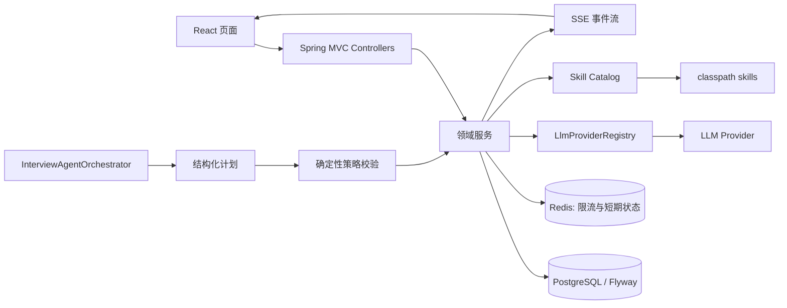

# Interview Guide 技术升级实施方案

> 文档类型：架构评审与实施设计  
> 目标项目：`D:\WorkPlace\Work\interview-guide\interview-guide`  
> 范围：自适应学习、普通 Chat、多轮面试；不包含旧项目数据迁移。  
> 基线：Java 25、Spring Boot 4.1、Spring AI 2、PostgreSQL + pgvector、Redis Stack、RustFS、React + TypeScript。

## 1. 结论与实施原则

当前项目具备接入三项能力的基础：已有面试会话/问答持久化、Skill 资源加载、LLM Provider 注册中心、SSE 流式输出、知识库对话和日历组件。升级不应复制旧项目的控制器和实体，而应以当前 Provider、Flyway、错误码、事务与前端路由规范为唯一基线实现。

已确定的产品决策如下：

| 项目 | 决策 |
| --- | --- |
| 多轮流程 | Agent 在受控边界内自主编排问题类别、追问、轮次结束和学习建议 |
| 算法题 | 提供 Java、Python、C++ 三种初始代码模板 |
| Chat Provider | 创建会话后禁止切换 Provider |
| 学习范围 | 同步覆盖所有 `skills/*/SKILL.md` 与 `skill.meta.yml` 中可解析的分类 |
| 学习计划 | 支持按日期拆分任务、站内提醒与浏览器通知 |
| 旧数据 | 不迁移；新能力从当前数据库的全新 Flyway 迁移开始 |

核心原则：LLM 只产生“建议计划”和结构化结果；状态变更、权限校验、预算限制、题目落库、评分落库和流程推进均由后端确定性代码执行。

## 2. 架构审查

### 2.1 可直接复用的能力

| 当前能力 | 复用方式 |
| --- | --- |
| `LlmProviderRegistry` | 所有新增 AI 请求通过 Provider ID 获取客户端；不新建全局单例 `ChatClient` |
| `StructuredOutputInvoker` | Agent 规划、学习路径、静态代码点评、报告均使用受约束 JSON 输出 |
| `InterviewSkillService` | 作为 Skill 发现、分类与参考资料解析的唯一入口；扩展只读查询能力 |
| `interview_sessions`、`interview_answers` | 多轮面试作为现有面试会话的扩展，而非并行的第二套普通面试表 |
| `RagChatSessionService` 与流式控制器 | 普通 Chat 的会话、消息占位、SSE 终态更新和异常恢复范式 |
| `interview_schedule` 前端日历 | 学习任务的日历呈现与日期交互；不复用其业务表 |
| Flyway | 所有 DDL 仅通过新增迁移文件执行，禁止修改 `V1__init_schema.sql` |

### 2.2 必须修正的设计风险

1. **不能让 Agent 直接写数据库或调用任意工具。** 当前注册中心默认会挂载 Skill 工具。多轮编排必须使用专用、受限的 `ChatClient`，只暴露白名单读取工具，实际写操作由编排服务校验计划后执行。
2. **Provider 固定不是复制密钥。** 会话保存 `provider_id` 与非敏感配置指纹（base URL、模型、temperature 的 SHA-256），请求时仍从 Provider 配置表解密密钥。Provider 被禁用或删除时，会话返回明确的“Provider 不可用”错误，不自动切换。
3. **“全部 Skill 覆盖”不能只依赖内存缓存。** 启动时应以 classpath 资源生成版本化目录快照，并根据内容哈希做幂等同步；无法解析元数据的 Skill 需记录为 `UNAVAILABLE`，不能静默遗漏。
4. **代码题不能宣称代码已运行。** 本期只提供编辑器、模板、保存与 AI 静态评审，不执行用户代码。运行沙箱、编译器、资源隔离和恶意代码防护属于后续独立能力。
5. **提醒只在可投递环境生效。** 站内提醒依赖用户打开应用；浏览器通知依赖用户授予权限且页面/Service Worker 可运行。没有账号体系、推送服务或邮件通道时，不承诺离线提醒。
6. **AI 调用不能持有数据库事务。** 先读取并创建 `PROCESSING` 状态，再在事务外调用模型，最终通过短事务落库；失败状态和幂等键必须可恢复。

## 3. 目标架构



新增模块建议如下，禁止跨 Controller 直接访问 Repository：

| 模块 | 包路径 | 职责 |
| --- | --- | --- |
| 学习 | `modules.learning` | Skill 目录、掌握度、学习计划、任务、提醒 |
| 普通对话 | `modules.chat` | 非知识库 Chat 会话、消息、流式输出 |
| 多轮面试 | `modules.multiround` | 轮次、算法提交、Agent 编排、轮次/总报告 |
| 共享 Agent | `common.ai.agent` | Agent 输入/输出 DTO、预算、策略校验、审计抽象 |

`modules.interview` 保持单轮面试领域职责；`modules.multiround` 仅通过其服务层复用题目生成、回答评估和报告能力，不直接依赖其 JPA Repository。

## 4. 数据模型与 Flyway 设计

### 4.1 迁移规则

- 新增连续、日期格式的迁移，例如 `V20260818__add_learning_and_chat_schema.sql`；实际日期以提交日为准。
- 每个迁移只做一个可回滚边界内的主题；索引和大量回填独立迁移。
- 所有外键使用 `ON DELETE RESTRICT` 默认策略；删除会话采用业务软删除/归档，不级联删除审计记录。
- `created_at`、`updated_at` 使用 `TIMESTAMP(6)`；枚举用 `VARCHAR` + `CHECK`，与现有风格一致。
- 不修改 V1，也不导入 `Work-inflow` 数据库数据。

### 4.2 建议迁移顺序

| 顺序 | 迁移主题 | 主要对象 |
| --- | --- | --- |
| 1 | 学习与目录 | `learning_skill_sources`、`learning_progress`、`learning_plans`、`learning_plan_tasks`、`learning_reminders` |
| 2 | 普通 Chat | `chat_sessions`、`chat_messages` |
| 3 | 多轮面试核心 | `multi_round_interviews`、`multi_rounds`、`multi_round_questions`、`algorithm_submissions` |
| 4 | Agent 审计 | `interview_agent_runs`、`interview_agent_steps` |
| 5 | 索引和约束 | 任务日期、会话时间线、轮次唯一性、幂等键索引 |

### 4.3 学习域

| 表 | 核心字段 | 约束与索引 |
| --- | --- | --- |
| `learning_skill_sources` | `skill_id`、`category_key`、`name`、`content_hash`、`status`、`synced_at` | `UNIQUE(skill_id, category_key)`；`status IN (ACTIVE, UNAVAILABLE)` |
| `learning_progress` | `skill_source_id`、`mastery_score`、`status`、`last_practiced_at` | `UNIQUE(skill_source_id)`；分数 0–100 |
| `learning_plans` | `title`、`goal`、`start_date`、`end_date`、`status`、`provider_id` | `status IN (DRAFT, ACTIVE, COMPLETED, ARCHIVED)` |
| `learning_plan_tasks` | `plan_id`、`skill_source_id`、`due_date`、`task_type`、`status`、`estimated_minutes` | `(plan_id, due_date)`、`(due_date, status)` 索引 |
| `learning_reminders` | `task_id`、`remind_at`、`channel`、`status`、`delivered_at` | `channel IN (IN_APP, BROWSER)`；`(status, remind_at)` 索引 |

目录同步仅更新平台维护字段，不覆盖用户进度。若源码分类消失，标记 `UNAVAILABLE`，保留历史计划与进度引用。

### 4.4 普通 Chat 域

`chat_sessions` 记录标题、状态、是否置顶、`provider_id`、`provider_fingerprint`、消息数、最后活动时间；`chat_messages` 记录会话、消息顺序、角色、内容、完成状态、失败原因和时间戳。

- `UNIQUE(session_id, message_order)` 保证顺序。
- `provider_id` 不允许在更新会话接口中修改。
- 创建时从当前默认 Chat Provider 写入；后续每次流式请求强制使用该 ID。
- 禁止将 API Key、密钥 nonce 或完整 Provider 配置写入业务表、日志、SSE 事件。

### 4.5 多轮面试域

| 表 | 核心字段 | 关键约束 |
| --- | --- | --- |
| `multi_round_interviews` | `interview_session_id`、`status`、`current_round_no`、`provider_id`、`provider_fingerprint`、`started_at`、`completed_at` | `UNIQUE(interview_session_id)`；一条普通会话最多一条多轮扩展 |
| `multi_rounds` | `multi_round_interview_id`、`round_no`、`round_type`、`status`、`question_limit`、`started_at`、`completed_at`、`report_json` | `UNIQUE(multi_round_interview_id, round_no)` |
| `multi_round_questions` | `round_id`、`sequence_no`、`question_type`、`category_key`、`question`、`reference_answer`、`status` | `UNIQUE(round_id, sequence_no)` |
| `algorithm_submissions` | `question_id`、`language`、`template_version`、`source_code`、`evaluation_json`、`score` | `language IN (JAVA, PYTHON, CPP)`；保留代码快照 |
| `interview_agent_runs` | `multi_round_interview_id`、`trigger`、`status`、`input_hash`、`output_json`、`started_at`、`finished_at` | 每次编排可追溯 |
| `interview_agent_steps` | `run_id`、`step_no`、`tool_name`、`input_summary`、`output_summary`、`duration_ms`、`status` | `UNIQUE(run_id, step_no)` |

`report_json`、`evaluation_json` 存结构化 JSON 文本并在 DTO 校验版本字段；若后续有跨报告筛选需求，再引入 JSONB 索引，不在第一期过早优化。

## 5. Agent 自主编排设计

### 5.1 执行模型

Agent 不是流程引擎，而是受限的规划器。每次触发由 `InterviewAgentOrchestrator` 生成上下文快照，并要求模型返回固定的 `InterviewPlan` JSON：

```text
trigger -> load snapshot -> AI plan -> schema validation -> policy validation
        -> deterministic persistence -> emit event -> next user action
```

允许 Agent 提议：分类配比、下一题、是否追问、轮次结束、下一轮建议、学习薄弱项。允许读取：当前简历、选中 Skill、JD、已授权知识库范围、当前轮问题/答案、当前会话状态和可用模板。禁止：直接写库、执行代码、文件/S3/网络访问、切换 Provider、跳过轮次状态机、读取其他会话。

### 5.2 状态机与预算

```text
CREATED -> ROUND_READY -> IN_PROGRESS -> ROUND_EVALUATING -> ROUND_COMPLETED
        -> NEXT_ROUND_READY -> ... -> COMPLETED -> EVALUATED
                                  \-> FAILED (仅异步/AI任务失败)
```

- 每次 Agent 运行最大 6 个规划步骤、每题最多 2 次追问、单轮最多 `question_limit` 题。
- 后端设置输入长度、输出 JSON 大小、模型超时、重试次数和总 token/费用预算；超限返回可恢复错误，不继续生成。
- AI 输出必须经 JSON Schema / `BeanOutputConverter` 解析与业务校验。非法类别、越界轮次或重复序号直接拒绝并记录审计。
- Agent 不可用时降级为确定性配额策略：按 Skill 优先级分题、固定轮次顺序、无额外追问；用户仍可完成面试。

### 5.3 轮次模型

默认四轮：`ALGORITHM`、`TECHNICAL_1`、`TECHNICAL_2`、`HR`。创建时允许根据 Skill 和 JD 生成计划，但必须满足：算法轮仅一次且首轮、轮号连续、总轮数 2–4、HR 只可位于最后。新建/开始/提交/结束请求均携带 `Idempotency-Key`，后端以会话、操作类型和请求键联合去重。

### 5.4 算法编辑器与静态评审

- 前端新增编辑器依赖（建议 CodeMirror 6 或 Monaco，二选一；不得同时引入），支持 Java/Python/C++ 语法高亮、复制、重置模板、未保存提示。
- 模板以 `language + template_version` 管理，后端返回不可变默认内容；提交时保存完整源代码快照。
- 评测输出仅包括思路、复杂度、边界情况、可读性和改进建议，并明确标注“AI 静态评审，未执行代码”。
- 禁止前端 `eval`、后端 `ProcessBuilder`、容器内编译。真实运行需单列 Sandbox 服务、资源限制、恶意输入防护和审计方案后再评审。

## 6. 自适应学习设计

### 6.1 Skill 目录同步

应用启动和受控管理接口触发 `LearningSkillCatalogSyncService`。它读取 `classpath:skills/*/SKILL.md` 与同目录 `skill.meta.yml`，规范化文本后计算 SHA-256，形成 `skill_id/category_key/content_hash` 快照。

- 成功解析的分类更新为 `ACTIVE`；缺元数据、重复 key、非法长度或引用不存在的条目写审计日志并标记 `UNAVAILABLE`。
- 同一哈希不写库；哈希变化才更新描述与版本时间。同步操作必须幂等。
- `_shared` 仅作为参考资料库，不作为独立学习主题；可通过其他 Skill 的分类关联进入学习任务。

### 6.2 进度、路径和计划

掌握度是 0–100 的领域指标，而不是模型自由文本。初始值 0；完成学习任务、提交练习、完成面试问题后由规则服务产生增量，AI 只能建议增量原因。建议先实现公式：

```text
mastery = clamp(0, 100,
  previous + taskCompletionDelta + exerciseDelta + interviewDelta - decayDelta)
```

各 Delta 的上限、权重和衰减周期置于 `LearningProperties`；更新使用乐观锁或条件更新，避免并发覆盖。学习路径服务读取进度、可用 Skill、目标日期和每日时长，生成草稿计划；用户确认后转为 `ACTIVE`，不可由 Agent 静默覆盖现有计划。

### 6.3 日期任务与提醒

- 任务的 `due_date` 是用户时区下的本地日期；提醒时间以含时区的 API 字符串传输，落库统一为 UTC 或明确应用时区，二者必须选其一并全局统一。
- 后端定时扫描到期 `PENDING` 提醒，仅标记为 `READY`；前端轮询或 SSE 拉取后显示站内提醒。
- 浏览器通知必须由前端显式申请权限，在页面/Service Worker 可用时投递。关闭浏览器后的提醒不在本期承诺范围。
- 学习任务不得写入 `interview_schedule`；日历组件通过统一 `CalendarEvent` 适配层同时展示两类数据。

## 7. 普通 Chat 设计

### 7.1 边界

普通 Chat 是不绑定知识库的通用对话；RAG Chat 保持原有“已选知识库 + 检索增强”语义。两者不得共用表并以可空知识库 ID 区分，避免数据语义和检索策略混杂。

### 7.2 接口

| 方法 | 路径 | 说明 |
| --- | --- | --- |
| `POST` | `/api/chat/sessions` | 新建会话并固化默认 Provider |
| `GET` | `/api/chat/sessions` | 分页列表，含置顶与最后活动时间 |
| `GET` | `/api/chat/sessions/{id}` | 会话及分页消息 |
| `PATCH` | `/api/chat/sessions/{id}` | 仅标题、置顶、归档；不接收 provider 字段 |
| `DELETE` | `/api/chat/sessions/{id}` | 归档或软删除，需明确产品保留策略 |
| `POST` | `/api/chat/sessions/{id}/messages/stream` | SSE 生成回复 |

流式顺序：校验 Provider 可用 -> 持久化用户消息与 `completed=false` 助手占位消息 -> 事务提交 -> 调用 LLM -> 推送增量 -> 短事务写入完成内容。网络断开时仍完成后台持久化；模型失败时写失败状态且前端提供重试，不重复写用户消息。

## 8. API、错误与安全约束

- 沿用 `Result<T>`、`BusinessException`、`ErrorCode`；新增错误码应区分 `PROVIDER_UNAVAILABLE`、`AGENT_PLAN_INVALID`、`AGENT_BUDGET_EXCEEDED`、`ROUND_STATE_INVALID`、`CODE_TOO_LARGE`、`REMINDER_PERMISSION_REQUIRED`。
- 新增写接口校验请求体大小、代码最大字符数、单消息长度、枚举值、日期范围和 ID 所属关系。
- 所有 LLM 输入使用现有 `PromptSanitizer` 与数据边界指令；检索内容、简历、JD、代码均视为不可信数据，不可改变系统指令。
- API Key 仅存 Provider 配置密文；日志仅记录 Provider ID、模型、会话 ID、耗时和错误类别，严禁记录源码全文、简历全文、消息全文或密钥。
- 新增 SSE 与 Agent 接口使用现有 Redis 限流机制，并按操作分类设置更严格阈值。

## 9. 前端改造

新增路由建议：`/learning`、`/learning/plans/:id`、`/chat`、`/interviews/:sessionId/multi-round`、`/interviews/:sessionId/multi-round/report`。

前端状态要求：

1. SSE 需处理连接中、增量、完成、错误、取消和刷新恢复；消息/问题须使用服务端 ID 去重。
2. 多轮页根据服务端状态渲染操作按钮，禁止本地推断下一轮可开始。
3. 代码编辑器只在算法轮挂载，切换语言前提示是否保留草稿；提交前显示“不会执行代码”。
4. 学习日历以任务状态、截止日、提醒状态展示；浏览器通知开关显示权限真实状态。
5. Chat 页面不展示 Provider 切换控件，创建会话后只展示当前模型信息（不展示密钥）。

## 10. 测试与验收

### 10.1 后端测试

- Flyway 空库迁移、重复迁移和升级迁移验证；断言表、约束、索引均存在。
- Skill 同步：全量 Skill、哈希不变、哈希变化、无效元数据、已删除来源的保留行为。
- Provider 固化：新会话记录 ID；默认 Provider 改变不影响旧会话；禁用 Provider 时旧会话失败且不回退。
- Agent：合法计划、非法 JSON、超预算、非法状态迁移、重复幂等键、模型不可用降级。
- 多轮：四轮正常流、跳轮拒绝、追问上限、算法三语言模板/快照、轮次报告和总报告。
- Chat：SSE 成功、断连、模型失败、消息排序、并发发送和重试幂等。
- 学习计划：分数边界、并发更新、跨日任务、提醒状态流转。

### 10.2 前端与端到端测试

- 新增路由可访问、刷新后能恢复会话。
- 三语言编辑器模板、草稿、提交、静态评审标签。
- SSE 重连与失败提示不产生重复气泡。
- 学习日历与提醒权限降级。
- Playwright 覆盖从创建多轮面试到总报告、创建学习计划到完成任务、普通 Chat 到刷新恢复三条主路径。

## 11. 发布计划与回退

| 阶段 | 交付物 | 开关/回退 |
| --- | --- | --- |
| A | 数据迁移、领域模型、目录同步、基础测试 | 新表不影响旧功能；迁移前备份数据库 |
| B | 普通 Chat 与学习目录/进度 | 路由功能开关；关闭后保留数据 |
| C | 学习计划、任务、提醒和日历适配 | 关闭提醒投递，不删除任务 |
| D | 多轮状态机、算法编辑器、确定性流程 | 禁用 Agent，回退到确定性编排 |
| E | 受控 Agent 规划、审计、报告 | 按 Provider/功能开关灰度；异常时立即降级 |

发布前必须在 `interview_guide_v2` 空库运行 Flyway，并对 RustFS、PostgreSQL、Redis 和至少一个已启用 Chat Provider 执行健康检查。当前已有容器只解决依赖可达性，不替代迁移验证和 AI Provider 连通性验证。

## 12. 实施完成判定

以下条件同时满足才可宣布升级完成：

- 全部新增 DDL 经 Flyway 在空库和已有当前版本数据库迁移成功，且 `validate` 通过。
- 全部可解析 Skill 被目录同步记录覆盖，异常 Skill 可查询且不影响其他 Skill。
- 普通 Chat 的 Provider 固化、SSE 持久化和异常恢复通过自动化测试。
- 多轮面试遵守状态机和预算；Agent 不可用时确定性流程可用；三种语言模板可提交并标注静态评审边界。
- 学习任务、进度、站内提醒和浏览器权限降级符合验收用例。
- 后端单元/集成测试、前端构建、关键 E2E 路径均通过；无密钥、完整提示词或完整用户内容输出到日志。

## 13. 本次审查的最终建议

优先顺序应为：先完成数据库迁移与确定性领域服务，再完成普通 Chat 与学习域，随后完成不依赖 Agent 的多轮状态机，最后以功能开关接入受控 Agent。这样在模型不稳定、Provider 不可用或提示词需要调整时，核心流程仍可运行，且所有 AI 决策可追溯、可复盘。
